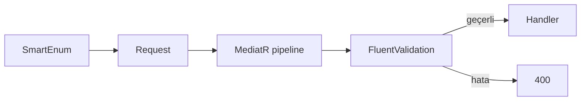
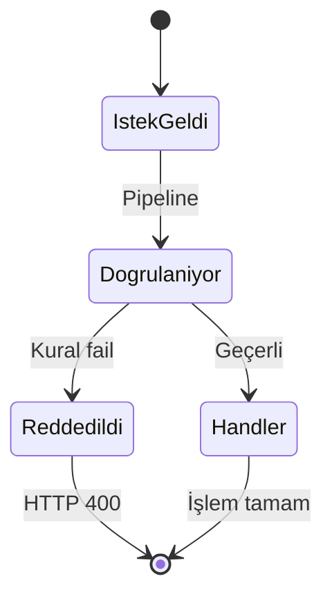

# 05 — FluentValidation ve SmartEnum

[← Önceki](04-cqrs-mediatr.md) · [İçindekiler](00-index.md) · [Sonraki →](06-jwt-rbac.md)

## Bu nedir?

**FluentValidation**: Request nesneleri için akıcı kurallar (`RuleFor…`).  
**Ardalis SmartEnum**: “sihirli string/int” yerine isimli, tip güvenli enum-benzeri sınıflar (`Pending`, `Approved`…).

**Benzetme:** FluentValidation kapıdaki **güvenlik kontrolü**; SmartEnum ise kart üzerindeki **resmi durum etiketi** (yanlış yazılamaz).



## Bu projede ne işe yarar?

- Create/approve/reject validator’ları hatalı tutarı veya boş geliri reddeder.
- `CreditApplicationStatus`, `CreditCategory`, `CreditRiskLevel` SmartEnum’dır (JSON’da genelde **name**).

## Ne zaman eklendi?

**Faz 1**.

## Temel kavramlar

| Kavram | Anlamı |
|--------|--------|
| **AbstractValidator\<T\>** | T için kural seti |
| **RuleFor** | Bir property kuralı |
| **When** | Koşullu kural |
| **SmartEnum** | `Name` + `Value` taşıyan sınıf |
| **TryFromName** | String → SmartEnum parse |



## Komutlar

```powershell
dotnet add src/Application package FluentValidation.DependencyInjectionExtensions
dotnet add src/Domain package Ardalis.SmartEnum
```

## Sınıflar, metotlar, paketler

| Örnek | Rol |
|-------|-----|
| `CreateCreditApplicationRequestValidator` | `MonthlyIncome` NotNull / GreaterThan(0) |
| `CreditApplicationStatus.Pending` | Durum sabiti |
| `CreditCategory.TryFromName(...)` | Filtre parse |

Paketler: `FluentValidation`, `FluentValidation.DependencyInjectionExtensions`, `Ardalis.SmartEnum`, `Ardalis.SmartEnum.SystemTextJson` (WebApi).

## Repoda nerede?

```
src/Application/**/**RequestValidator.cs
src/Domain/Enums/
src/WebApi  # SmartEnum JSON converter kaydı
```

## Mini akış

İstek gelir → `RequestValidationBehavior` validator bulur → kural fail → `ValidationException` → ProblemDetails 400.  
Başarılıysa handler’a geçilir; status karşılaştırması `CreditApplicationStatus.Pending` ile yapılır.

## Yeni başlayan lab

1. `CreateCreditApplicationRequestValidator` dosyasını aç → `RuleFor` örneklerini oku.
2. API’ye geçersiz body gönder (ör. `monthlyIncome: 0`) → 400 ProblemDetails.
3. `CreditApplicationStatus.Pending.Name` ile JSON’da dönen status alanını karşılaştır.
4. `TryFromName` ile bilinmeyen string → false / hata davranışını test et.
5. Geçerli istek → handler çalışır, status Pending kalır.

## Sık yapılan hatalar

- C# `enum` ile SmartEnum karıştırmak → JSON serileştirme farklı.  
- Validator yazıp `AbstractValidator`’dan türetmemek → pipeline bulamaz.  
- Magic string `"Pending"` kullanmak → `CreditApplicationStatus.Pending` kullan.  

## Nerede işe yarar?

- [ ] Kötü input API’ye ulaşmadan kesiliyor  
- [ ] Durumlar tek kaynakta (Domain/Enums)  
- [ ] Hata mesajları alan bazlı okunuyor  
