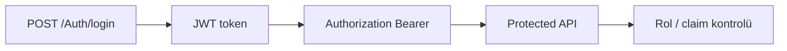
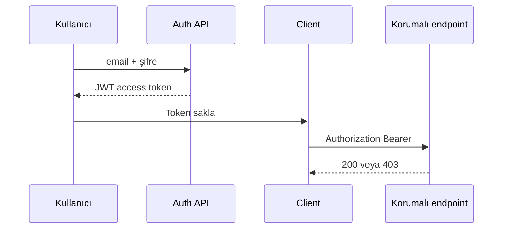

# 06 — JWT ve RBAC

[← Önceki](05-validation-smartenum.md) · [İçindekiler](00-index.md) · [Sonraki →](07-serilog-seq.md)

## Bu nedir?

**JWT** (JSON Web Token): Girişten sonra istemcinin her istekte gönderdiği imzalı kimlik bileti.  
**RBAC** (Role-Based Access Control): Yetkiyi **role** göre verme (`Customer`, `BankStaff`, `BankManager`).

**Benzetme:** JWT konser **bilek bandı**; kapıdaki görevli (API) bandındaki role bakarak sahneye (endpoint) alır veya almaz.



## Bu projede ne işe yarar?

- `POST /api/Auth/login` → access token.
- Customer kendi başvurusunu oluşturur/iptal eder; Staff onaylar; Manager kredi tipi yönetir.
- MediatR `ISecuredRequest` + `Roles` listesi pipeline’da kontrol edilir.

## Ne zaman eklendi?

**Faz 2** (BankManager sonradan genişletildi).

## Temel kavramlar

| Kavram | Anlamı |
|--------|--------|
| **Claim** | Token içindeki küçük bilgi (sub, role, email) |
| **Bearer** | `Authorization: Bearer <token>` şeması |
| **Access token** | API erişim bileti (kısa ömürlü olabilir) |
| **Password hash** | Şifrenin düz metin saklanmaması |
| **ICurrentUserService** | Token’dan okunan kullanıcı bağlamı |



## Komutlar

JWT üretimi CLI ile değil; test için:

```powershell
# API ayaktayken (örnek)
curl -X POST http://localhost:8080/api/Auth/login `
  -H "Content-Type: application/json" `
  -d "{\"email\":\"staff.tr@bank.local\",\"password\":\"Demo123!\"}"
```

Demo hesaplar: kök `README.md` / `README.tr.md`.

## Sınıflar, metotlar, paketler

| İsim | Rol |
|------|-----|
| `LoginRequestHandler` | Şifre doğrula, token üret |
| `ITokenHelper` / JWT ayarları | İmza + claim |
| `ICurrentUserService` | `UserId`, `IsBankManager`, … |
| `AuthorizationBehavior` | Rol yoksa `AuthorizationException` |
| `GeneralOperationClaims` | Rol sabitleri |

Paketler: `Microsoft.AspNetCore.Authentication.JwtBearer`, `System.IdentityModel.Tokens.Jwt`.

## Repoda nerede?

```
src/Application/Modules/Identity/Features/Auth/
src/WebApi/Modules/Identity/
src/Core/Security/
src/Core/Application/Pipelines/Authorization/
```

## Mini akış

Login → hash karşılaştır → JWT claim’lere roller yaz → client header’a koy → her MediatR command’de rol kontrolü.

Ekran örneği (giriş): [`Login Page and Privacy.png`](../../assets/screenshots/en/Login%20Page%20and%20Privacy.png)

## Yeni başlayan lab

1. README’deki demo hesapla `POST /api/Auth/login` (curl veya Scalar).
2. Dönen token’ı jwt.io’da aç → `role` claim’lerini oku (commit etme).
3. Staff token ile onay endpoint’ini dene → 200.
4. Customer token ile aynı endpoint → 403 bekle.
5. Client’ta login → Network’te sonraki isteklerde `Bearer` header’ını doğrula.

## Sık yapılan hatalar

- Token’ı query string’de loglamak / paylaşmak → sadece header.  
- Süresi dolmuş token ile denemek → yeniden login.  
- Rol adını kodda typo ile yazmak → `GeneralOperationClaims` sabitlerini kullan.  

## Nerede işe yarar?

- [ ] Login token üretiyor  
- [ ] Yanlış rol 403  
- [ ] `ICurrentUserService` doğru kullanıcıyı görüyor  
