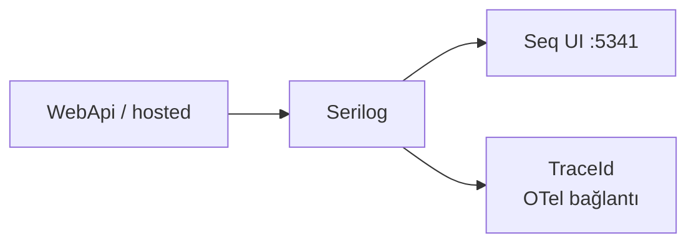
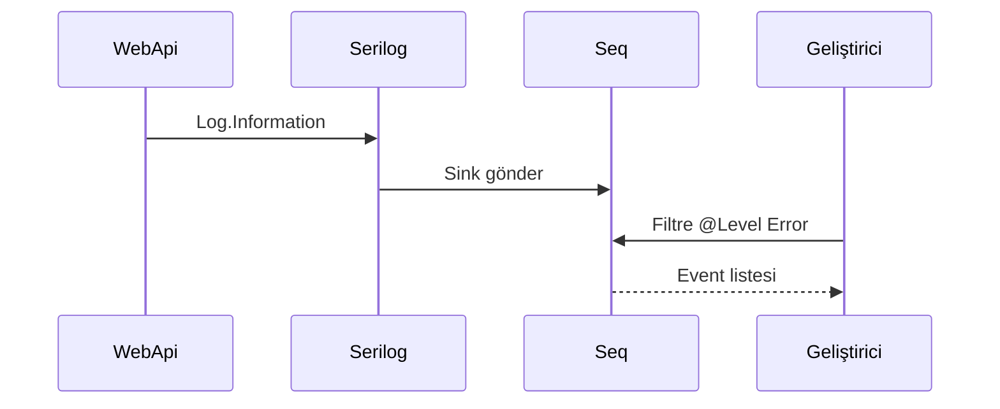

# 07 — Serilog ve Seq

[← Önceki](06-jwt-rbac.md) · [İçindekiler](00-index.md) · [Sonraki →](08-redis.md)

İlgili lab özeti: [24 — Lab tools](24-lab-tools.md) · Compose kurtarma: [09](09-docker-compose.md)

## Bu nedir?

**Serilog**: Yapılandırılmış (.structured) log kütüphanesi.  
**Seq**: Bu logları toplayıp UI’da aramanı sağlayan sunucu (lab’de Docker).

**Benzetme:** Serilog mutfaktaki **aşçı defteri**; Seq ise defterleri indeksleyen **arama motoru** — “dün kim login oldu?” sorusu saniyede yanıtlanır.



## Bu projede ne işe yarar?

- İstek pipeline hataları, audit (`IAuditLogger` / `SerilogAuditLogger`), host yaşam döngüsü.
- OTel açıkken TraceId ile ilişkilendirme mümkün (log ↔ trace).
- Karar mektubu / e-posta lab mesajları da Seq’e düşer (SMTP yok).

## Ne zaman eklendi?

**Faz 2**; Compose ile Seq **Faz 3**.

## Temel kavramlar

| Kavram | Anlamı |
|--------|--------|
| **Sink** | Log’un gittiği yer (konsol, Seq, dosya) |
| **Enricher** | Ortam adı, machine name gibi ek alan |
| **Structured log** | `"{UserId} login"` gibi property’li mesaj |
| **Audit** | “Kim ne yaptı?” iş olayı |
| **Signal** | Seq’te kayıtlı arama / uyarı (lab’de isteğe bağlı) |



## Komutlar

```powershell
cd infra

# Seq konteynerini başlat (stack zaten up ise gerekmez)
docker compose --env-file .env up -d seq
# Kontrol: compose ps → seq healthy; tarayıcı http://localhost:5341 açılır (lab’de login yok)
```

```powershell
# Seq ayakta mı / log basıyor mu?
docker compose --env-file .env ps seq
docker compose --env-file .env logs --tail=50 seq
# WebApi tarafı sink hatası için:
docker compose --env-file .env logs --tail=80 webapi
```

**Seq UI (http://localhost:5341) — ne bakılır?**

1. Events listesi — yeni login / CreditTypes GET sonrası satır geliyor mu?
2. Filtre örnekleri (üst arama kutusu):
   - `@Level = 'Error'` — sadece hatalar
   - `Application like '%BankApp%'` — uygulama adı
   - `RequestPath like '/api/%'` — API istekleri
   - `TraceId = '...'` — Grafana Tempo’dan kopyalanan id (OTel açıksa)
3. Bir event’e tıkla → property paneli (UserId, StatusCode, vb.).

```powershell
# Host’tan UI’ye kaba erişim testi (PowerShell)
curl -s -o NUL -w "%{http_code}`n" http://localhost:5341
# Beklenen: 200 (veya Seq’in yönlendirdiği kod); bağlantı yoksa compose ps
```

### Ne kontrol edilir?

| Kontrol | Nasıl | İyi görünüm |
|---------|-------|-------------|
| Seq healthy | `compose ps seq` | healthy |
| UI | `:5341` | Events yüklenir |
| Sink çalışıyor | Login veya `/api/...` → Seq Events | Yeni satır + timestamp |
| Trace köprüsü | Grafana’da TraceId → Seq filtre | Aynı id’li log |

### Felaket / kurtarma (lab)

| Durum | Yol |
|-------|-----|
| UI boş ama API çalışıyor | `logs webapi` — Seq adres/bağlantı hatası? Compose’ta Seq URL `http://seq` |
| Seq restart loop | `logs seq`; volume bozulduysa aşağıdaki reset |
| Disk / eski lab log kalabalığı | Seq (+ Redis) volume sıfırla — **yıkıcı** |

```powershell
# Yıkıcı: Seq (ve compose -v ile silinen diğer) lab verisi gider; SQL external kalır
# docker compose --env-file .env down -v
# docker compose --env-file .env up -d --build
```

**Best practice:** Şifre / ham JWT / tam PII loglama. Prod’da Seq auth + retention. Lab’de Error ile başla, sonra Information.

## Sınıflar, metotlar, paketler

| Paket / sınıf | Rol |
|---------------|-----|
| `Serilog.AspNetCore` | Host entegrasyonu |
| `Serilog.Sinks.Seq` | Seq sink |
| `UseSerilogRequestLogging` | HTTP istek logu |
| `IAuditLogger.Log(...)` | Auth / Credit audit kategorileri |

## Repoda nerede?

```
src/WebApi/Program.cs          # Serilog bootstrap
src/Application/Services/Logging/
infra/docker-compose.yml       # seq servisi
infra/README.md
```

## Mini akış

Exception → LoggingBehavior / middleware → Serilog → Seq UI’da event listesi.  
OTel açıksa aynı isteğin TraceId’si Grafana + Seq’te eşleşir.

Ekran (Seq Events — yapısal log listesi):


## Yeni başlayan lab

1. `cd infra` → `docker compose --env-file .env up -d seq webapi`.
2. Tarayıcı `http://localhost:5341` → Events boş değil mi kontrol et.
3. Uygulamada login yap → Seq’te yeni satır.
4. Filtre: `@Level = 'Error'` → kasıtlı hata üretmeden önce boş olabilir.
5. `docker compose logs --tail=30 webapi` → Seq sink hatası var mı?

## Sık yapılan hatalar

- Seq ayaktayken WebApi host’tan çalıştırıp yanlış Seq URL → container içi `http://seq`.  
- Düz string birleştirerek loglamak → structured property kullan.  
- JWT/şifreyi Information seviyesinde yazmak → maskele veya audit kategorisi.  

## Nerede işe yarar?

- [ ] Login sonrası Seq’te event  
- [ ] Error filtre çalışıyor  
- [ ] `compose ps seq` healthy  
