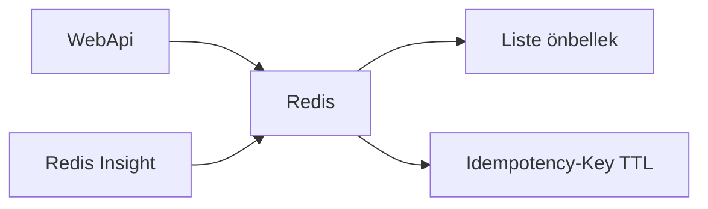
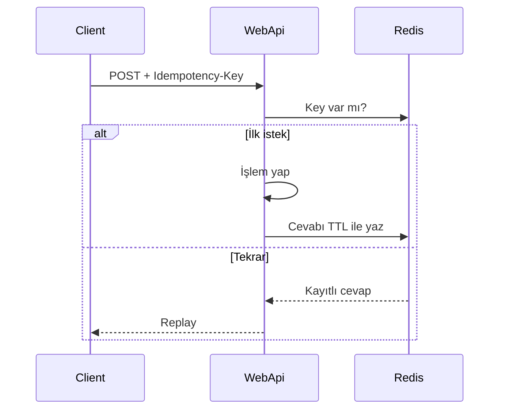

# 08 — Redis (önbellek ve Idempotency)

[← Önceki](07-serilog-seq.md) · [İçindekiler](00-index.md) · [Sonraki →](09-docker-compose.md)

## Bu nedir?

**Redis**: Bellekte çalışan çok hızlı key-value store.  
BankApp’te iki ana iş: **cache** (liste) ve **Idempotency-Key** saklama.

**Benzetme:** Redis bankanın **hızlı not defteri** — sık okunan liste sayfaları deftere yazılır; idempotency ise “bu fiş numarası zaten işlendi” damgasıdır.



## Bu projede ne işe yarar?

1. Kredi tipi / alt tip listesi gibi okumaları hızlandırmak (`ICacheRemoverRequest` ile invalidate).
2. Aynı `Idempotency-Key` ile tekrarlayan create/approve/reject/cancel’ı güvenli yönetmek (24 saat TTL).
3. Lab’de anahtarları tarayıcıdan görmek için **Redis Insight** UI (`http://localhost:5540`).

## Ne zaman eklendi?

Cache: **Faz 2–3**. Idempotency: **Faz 6**. Redis Insight UI: lab (Compose).

## Temel kavramlar

| Kavram | Anlamı |
|--------|--------|
| **Key / Value** | Anahtar ve değer |
| **TTL** | Key’in otomatik silinme süresi |
| **Cache stampede** | Cache boşalınca ani DB yükü (bilinçli olmak için) |
| **Idempotency** | Aynı isteği iki kez göndersen aynı etki / replay |
| **Redis Insight** | Resmi web UI; Redis’in kendisinde yerleşik arayüz yoktur |



## Komutlar

```powershell
cd infra
docker compose --env-file .env up -d redis redis-insight

# Container içine girip key bakmak (opsiyonel)
docker compose exec redis redis-cli KEYS "*"
```

Tarayıcı: `http://localhost:5540` → **Add Redis database** → Host **`redis`**, Port **`6379`**, şifre = `REDIS_PASSWORD` (`.env` / Vault `secret/bankapp/cache`).  
(`localhost` Insight konteynerinden Redis’e gitmez; Compose servis adı kullanılır.)

Ekran (Redis Insight):


HTTP tarafı:

```http
POST /api/CreditApplications
Idempotency-Key: 3f2c9a...   # istemci üretir (UUID)
```

## Sınıflar, metotlar, paketler

| İsim | Rol |
|------|-----|
| `Microsoft.Extensions.Caching.StackExchangeRedis` | IDistributedCache |
| Cache pipeline / `ICacheRemoverRequest` | Yazınca grubu temizle |
| Idempotency middleware / filter (WebApi Credit) | Key + body hash kontrolü |

## Repoda nerede?

```
src/WebApi/…          # Redis DI, idempotency
src/Core/…            # cache pipeline parçaları
infra/docker-compose.yml   # redis + redis-insight
infra/.env.example         # REDIS_INSIGHT_PORT
tests/.../IdempotencyKeyTests.cs
```

## Mini akış (Idempotency)

İlk POST + Key → işlem yapılır, cevap Redis’e yazılır.  
Aynı Key + aynı body → kayıtlı cevap replay (ikinci outbox yok).  
Aynı Key + farklı body → **409 Conflict**.

## Yeni başlayan lab

1. `docker compose up -d redis redis-insight` (`infra`).
2. Insight’ta host **`redis`**, port **6379** ile bağlan.
3. Kredi türü listesini UI’da aç → sonra Redis’te cache key’lerine bak.
4. Aynı `Idempotency-Key` ile iki POST (integration test veya Postman).
5. `redis-cli PING` → `PONG`.

## Sık yapılan hatalar

- Insight’ta host olarak `localhost` kullanmak → Compose servis adı `redis`.  
- Idempotency key’i her istekte değiştirmek → tekrar koruması kalkar.  
- Cache invalidate etmeyen yazma → eski liste görünür (`ICacheRemoverRequest`).  

## Nerede işe yarar?

- [ ] `PING` PONG  
- [ ] Insight bağlantısı yeşil  
- [ ] Tekrarlayan POST çift işlem üretmiyor  
