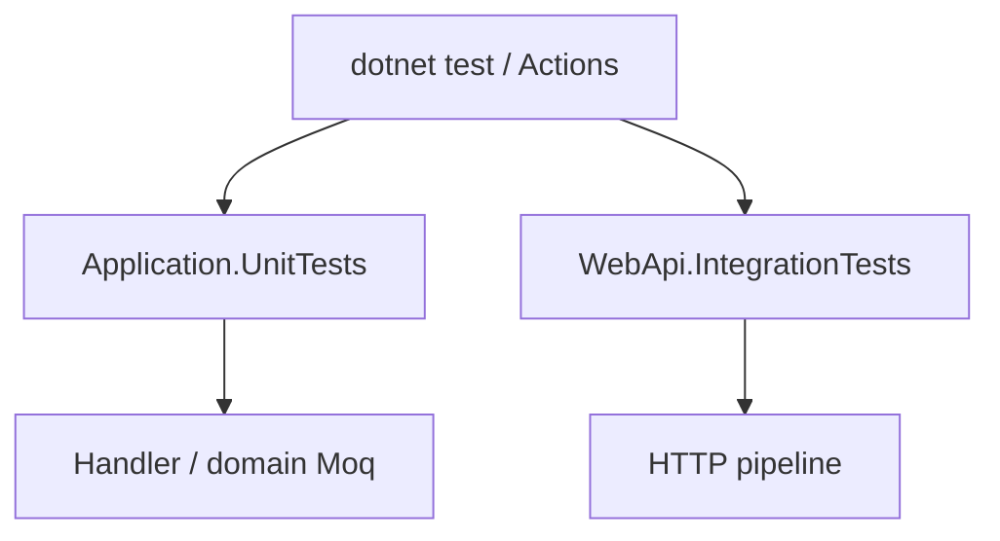
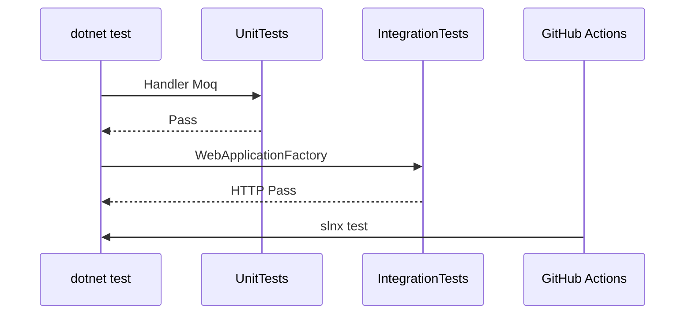

# 10 — Testler (xUnit, Moq, Integration)

[← Önceki](09-docker-compose.md) · [İçindekiler](00-index.md) · [Sonraki →](11-react-vite.md)

## Bu nedir?

**Unit test**: Küçük birimi (handler, kural) izole test eder; bağımlılıklar **mock**.  
**Integration test**: Gerçek WebApi pipeline’ını (`WebApplicationFactory`) ayağa kaldırıp HTTP ile dener.

**Benzetme:** Unit test tek **vidayı** tornavida ile dener; integration test montaj hattında **arabanın** bir tur atmasını izler.



## Bu projede ne işe yarar?

- `Application.UnitTests`: domain kuralları, saga, approve handler, validator…
- `WebApi.IntegrationTests`: login, create→approve, idempotency, müşteri cancel…
- CI her push’ta bunları koşar.

## Ne zaman eklendi?

Unit: **Faz 3**. Integration iskeleti → akışlar: **Faz 5**.

## Temel kavramlar

| Kavram | Anlamı |
|--------|--------|
| **xUnit** | `[Fact]` / `[Theory]` test framework |
| **Moq** | `Mock<T>`, `Setup`, `Verify` |
| **FluentAssertions** | `Should().Be(...)` okunaklı assert |
| **WebApplicationFactory** | Test sunucusu |
| **AAA** | Arrange / Act / Assert |



## Komutlar

```powershell
# Tüm testler
dotnet test BankApp.slnx

# Sadece unit
dotnet test tests/Application.UnitTests/Application.UnitTests.csproj

# Sadece integration
dotnet test tests/WebApi.IntegrationTests/WebApi.IntegrationTests.csproj --configuration Release

# Filtre
dotnet test --filter "FullyQualifiedName~ApproveCreditApplication"
```

| Bayrak | Anlamı |
|--------|--------|
| `--filter` | İsim kalıbına göre test seç |
| `--no-build` | CI’da build ayrı adımsa |
| `-v normal` | Daha ayrıntılı çıktı |

## Sınıflar, metotlar, paketler

| Paket | Rol |
|-------|-----|
| `xunit`, `Microsoft.NET.Test.Sdk` | Runner |
| `Moq` | Mock |
| `FluentAssertions` | Assert |
| `Microsoft.AspNetCore.Mvc.Testing` | Integration host |
| `Microsoft.EntityFrameworkCore.InMemory` | Hafif DB (factory’ye göre) |

Örnek: `ApproveCreditApplicationRequestHandlerTests` — `ICurrentUserService` + `IApplicationUserRepository` mock → `DecisionBy` e-posta.

## Repoda nerede?

```
tests/Application.UnitTests/
tests/WebApi.IntegrationTests/
tests/WebApi.IntegrationTests/Infrastructure/CustomWebApplicationFactory.cs
.github/workflows/ci.yml
```

## Mini akış (CI)

`dotnet restore` → `dotnet build` → unit test → integration test → (paralel) client `npm` build.

Ekran (lab stack):


## Yeni başlayan lab

1. `dotnet test tests/Application.UnitTests` — hızlı yeşil paket.
2. Tek test: `--filter "FullyQualifiedName~ApproveCreditApplication"`.
3. `CustomWebApplicationFactory.cs` dosyasını oku — host nasıl kuruluyor?
4. Integration projesini Release ile koş (CI ile aynı).
5. Kasıtlı assert kır → kırmızı çıktıyı oku → düzelt.

## Sık yapılan hatalar

- Integration’da gerçek SQL bekleyip factory InMemory kullanmak → dokümantasyonu oku.  
- Mock’ları `Verify` etmemek → yan etkisiz geçen test.  
- Sadece happy path — negatif senaryo (403, 400) de ekle.  

## Nerede işe yarar?

- [ ] Lokal `dotnet test BankApp.slnx` yeşil  
- [ ] CI workflow aynı komutu kullanıyor  
- [ ] Yeni handler’a unit test eklenebiliyor  
