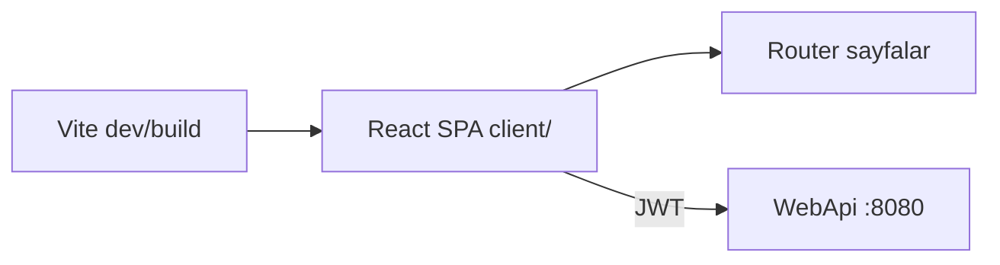
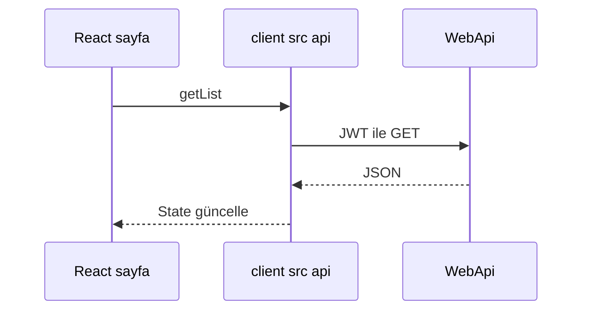

# 11 — React, Vite ve TypeScript

[← Önceki](10-testing.md) · [İçindekiler](00-index.md) · [Sonraki →](12-i18n-ux.md)

## Bu nedir?

**React**: Bileşen tabanlı UI kütüphanesi.  
**Vite**: Hızlı geliştirme sunucusu + production bundler.  
**TypeScript**: Tipli JavaScript — hataları derlemede yakalar.

**Benzetme:** React **Lego** kutusu (bileşenler); Vite hızlı **montaj masası**; TypeScript eksik parçayı daha kutuyu açmadan uyarır.



## Bu projede ne işe yarar?

`client/` SPA: login, dashboard, başvurular, müşteriler, kredi türleri, personel, profil; API’ye JWT ile konuşur.

## Ne zaman eklendi?

**Faz 4**.

## Temel kavramlar

| Kavram | Anlamı |
|--------|--------|
| **Component** | `function Foo() { return <div/> }` |
| **Hook** | `useState`, `useEffect`, custom hook |
| **SPA** | Tek sayfa; client-side routing |
| **react-router** | URL → sayfa |
| **Fetch / api module** | HTTP istemci katmanı |



## Komutlar

```powershell
cd client
npm install          # package-lock’tan bağımlılık
npm run dev          # geliştirme sunucusu
npm run build        # tsc + vite production
npm run preview      # build çıktısını önizle
```

| Script | Ne yapar? |
|--------|-----------|
| `dev` | HMR ile local UI |
| `build` | `dist/` üretir (Docker nginx bunu sunar) |

Ortam: `VITE_API_BASE_URL` (Compose’ta build-arg).

## Sınıflar, metotlar, paketler

| Paket / dosya | Rol |
|---------------|-----|
| `react`, `react-dom` | UI |
| `react-router-dom` | Rotalar |
| `@microsoft/signalr` | Canlı bildirim |
| `client/src/api/*` | REST sarmalayıcılar |
| `AuthContext` | Token / kullanıcı state |
| `formatMoney` / `currencySymbol` | Para gösterimi |

## Repoda nerede?

```
client/package.json
client/src/main.tsx
client/src/pages/
client/src/api/
client/Dockerfile
```

## Mini akış

`npm run dev` → Login → token localStorage/context → ApplicationsPage list çeker → SignalR toast.

Ekran (personel SPA dashboard):


Müşteri SPA dashboard:


## Yeni başlayan lab

1. `cd client` → `npm install` → `npm run dev`.
2. `.env` / `VITE_API_BASE_URL` API adresini gösteriyor mu kontrol et.
3. Login → DevTools Application → token/context.
4. `src/pages` altında Applications sayfasını bul → hangi `api/` modülü çağrılıyor?
5. `npm run build` → `dist/` oluşumu (Docker ile aynı).

## Sık yapılan hatalar

- API kapalıyken CORS sanmak → önce `8080/health`.  
- `any` ile TypeScript’i devre dışı bırakmak → `client/src/api` tiplerini kullan.  
- Production’da yanlış `VITE_*` build-arg → Compose `.env` ile yeniden build.  

## Nerede işe yarar?

- [ ] `npm run dev` açılıyor  
- [ ] Login sonrası korumalı sayfalar yükleniyor  
- [ ] `npm run build` CI ile uyumlu  
