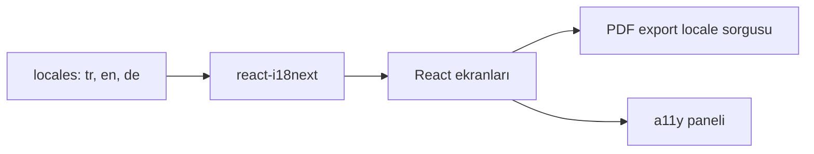
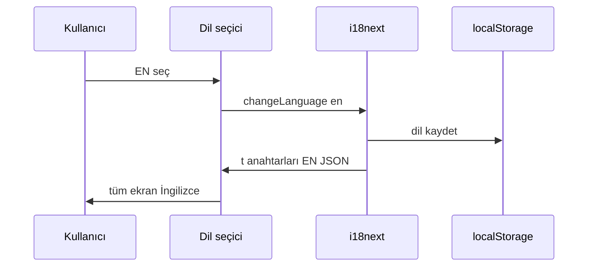

# 12 — i18n ve UX (erişilebilirlik, gizlilik)

[← Önceki](11-react-vite.md) · [İçindekiler](00-index.md) · [Sonraki →](13-rabbitmq.md)

## Bu nedir?

**i18n** (internationalization): Arayüz metinlerini dil dosyalarından okumak; kodda sabit Türkçe/Almanca/İngilizce cümle tutmamak.  
BankApp: **TR / EN / DE** (`react-i18next`).  
Ayrıca erişilebilirlik paneli, çerez/Datenschutz bandı, tema.

**Benzetme:** i18n = otelin üç dilde yazılmış **resepsiyon kartı**; erişilebilirlik paneli = ışığı ve yazıyı ayarlayan **kumanda**. Aynı oda, farklı diller ve konfor tercihleri.



## Bu projede ne işe yarar?

- Aynı ekran üç dilde; personel ve müşteri dilini seçer.
- Seed ürün adları locale’e göre (`tr` başvuruda farklı metin).
- PDF export locale query (`tr` / `en` / `de`) API’ye gider.
- Tema / font / kontrast tercihleri tarayıcıda saklanır (`localStorage`).
- Genişletilmiş a11y kiti: [34 — a11y portable kit](34-a11y-portable-kit.md).

## Ne zaman eklendi?

i18n: **Faz 4**. Erişilebilirlik + privacy: **Faz 5**.

## Temel kavramlar

| Kavram | Anlamı |
|--------|--------|
| **Locale** | `tr`, `en`, `de` — aktif dil kodu |
| **Translation key** | `applications.approve` — JSON’daki yol |
| **t('key')** | React içinde çeviri fonksiyonu |
| **Namespace** | Büyük JSON’ları bölmek için (opsiyonel) |
| **Persisted preference** | Dil ve tema `localStorage`’da |
| **Interpolation** | `{{amount}}` gibi değişken yer tutucular |



## Komutlar

Özel CLI yok. Dil değiştirmek UI’dan; geliştirmede:

```powershell
cd client
npm run dev
```

JSON çeviri dosyalarını düzenle → HMR ile hemen görünür (sayfayı yenilemek gerekmez).

Üretim build’inde eksik anahtar kontrolü için:

```powershell
cd client
npm run build
```

Build sırasında TypeScript/ESLint uyarılarında bilinmeyen `t()` anahtarı varsa düzelt.

## Sınıflar, metotlar, paketler

| Paket / dosya | Rol |
|---------------|-----|
| `i18next`, `react-i18next` | Çeviri motoru + React hook’ları |
| `client/src/i18n/` | Init, fallback dili, detector |
| `client/src/locales/` veya ilgili JSON | TR/EN/DE string dosyaları |
| Accessibility floating panel | Tema / A± / kontrast |
| Privacy banner | İlk ziyaret onayı |

Taşınabilir asistan detayı: [34 — a11y portable kit](34-a11y-portable-kit.md).

## Repoda nerede?

```
client/src/i18n/
client/src/locales/
client/src/a11y/
client/src/components/AccessibilityToolbar
docs/assets/screenshots/en/Accessiblity Settings.png
```

## Mini akış

Kullanıcı EN seçer → `i18n.changeLanguage('en')` → tüm `t()` key’leri EN JSON’dan → PDF indirirken `locale=en` API’ye gider → a11y paneli kontrastı aynı oturumda korunur.

Dil değişimi (aynı ekran, farklı locale):


Erişilebilirlik paneli (tema / font / kontrast):


## Yeni başlayan lab

1. `npm run dev` → http://localhost:3000 — sağ üstten **DE** seç.
2. Başvuru listesinde buton etiketlerinin Almanca olduğunu doğrula.
3. TE’ye dön → `localStorage`’da dil anahtarının güncellendiğini gör (DevTools → Application).
4. Erişilebilirlik simgesi → kontrastı artır → sayfayı yenile → tercihin kaldığını kontrol et.
5. Onaylanmış bir başvuruda PDF indir → istek URL’sinde `locale=` parametresini Network sekmesinde incele.

## Sık yapılan hatalar

- Metni JSX içine doğrudan yazmak (`"Onayla"`) — sonraki dile geçişte unutulur  
- Sadece bir dil JSON’una anahtar ekleyip diğerlerini boş bırakmak → fallback veya ham key görünür  
- `changeLanguage` sonrası API’ye hâlâ sabit `tr` locale göndermek (PDF/export)  
- a11y stillerini global CSS ile ezerek panel ayarlarının etkisiz kalması  

## Nerede işe yarar?

- [ ] Üç dilde aynı ekranlar tutarlı metin gösteriyor  
- [ ] Dil seçimi yenileme sonrası korunuyor  
- [ ] PDF/export isteği seçili `locale` ile gidiyor  
- [ ] Erişilebilirlik paneli kontrast/font tercihini saklıyor  
- [ ] Privacy bandı ilk ziyarette görünüp onay sonrası kayboluyor (lab)
