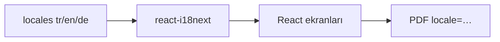

# 12 — i18n ve UX (erişilebilirlik, gizlilik)

[← Önceki](11-react-vite.md) · [İçindekiler](00-index.md) · [Sonraki →](13-rabbitmq.md)

## Bu nedir?

**i18n** (internationalization): Arayüz metinlerini dil dosyalarından okumak.  
BankApp: **TR / EN / DE** (`react-i18next`).  
Ayrıca erişilebilirlik paneli, çerez/Datenschutz bandı, tema.



## Bu projede ne işe yarar?

- Aynı ekran üç dilde.
- Seed ürün adları locale’e göre.
- PDF export locale query (`tr`/`en`/`de`).
- Tema / font / kontrast tercihleri tarayıcıda saklanır.

## Ne zaman eklendi?

i18n: **Faz 4**. Erişilebilirlik + privacy: **Faz 5**.

## Temel kavramlar

| Kavram | Anlamı |
|--------|--------|
| **Locale** | `tr`, `en`, `de` |
| **Translation key** | `applications.approve` |
| **t('key')** | Çeviri fonksiyonu |
| **Persisted preference** | localStorage |

## Komutlar

Özel CLI yok. Dil değiştirmek UI’dan; geliştirmede:

```powershell
cd client
npm run dev
```

JSON çeviri dosyalarını düzenle → HMR ile hemen görünür.

## Sınıflar, metotlar, paketler

| Paket / dosya | Rol |
|---------------|-----|
| `i18next`, `react-i18next` | Çeviri motoru |
| `client/src/i18n/` veya `locales/` | Dil JSON’ları |
| Accessibility floating panel | Tema / A± / kontrast (+ genişletilmiş a11y kiti) |
| Privacy banner | İlk ziyaret onayı |

Taşınabilir asistan detayı: [34 — a11y portable kit](34-a11y-portable-kit.md).

## Repoda nerede?

```
client/src/  # i18n init, a11y/, components/AccessibilityToolbar, privacy
docs/assets/screenshots/en/Accessiblity Settings.png
```

## Mini akış

Kullanıcı EN seçer → `i18n.changeLanguage('en')` → tüm `t()` key’leri EN JSON’dan → PDF indirirken `locale=en` API’ye gider.
