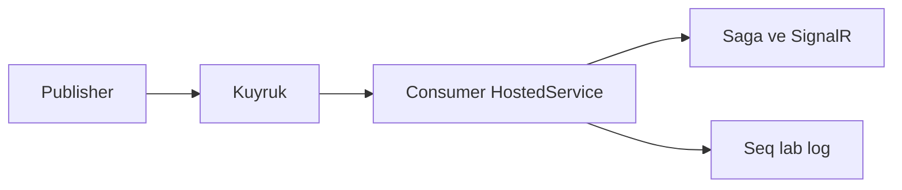
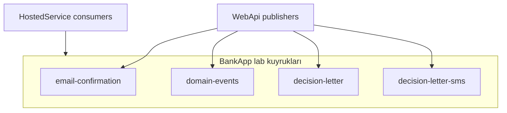

# 13 — RabbitMQ

[← Önceki](12-i18n-ux.md) · [İçindekiler](00-index.md) · [Sonraki →](14-outbox-events.md)

İlgili: [14 Outbox](14-outbox-events.md) · [22 Decision letter](22-decision-letter-email.md) · [24 Lab tools](24-lab-tools.md) · [09 Compose](09-docker-compose.md)

## Bu nedir?

**RabbitMQ**: Mesaj kuyruğu (AMQP broker). Üretici mesajı kuyruğa bırakır; tüketici (consumer) zamanı gelince işler.  
HTTP isteğini yavaş işlerden (e-posta simülasyonu, event yayını) ayırır — kullanıcı “Gönder”e basınca API hemen 200 döner, arka planda kuyruk işi biter.

**Benzetme:** Süpermarket **numaratör** — kasiyer (API) fişi keser, mutfak (consumer) sırayla hazırlar. Müşteri kasada beklemez.



## Bu projede ne işe yarar?

| Kuyruk (lab) | Ne taşır? |
|--------------|-----------|
| `email-confirmation` | Kayıt sonrası e-posta doğrulama (JWT hemen yok) |
| `domain-events` | Outbox → Saga + SignalR |
| `decision-letter` | Onay/red sonrası karar mektubu e-posta (Seq’e log; SMTP yok) |
| `decision-letter-sms` | Onay/red sonrası SMS lab (Seq’e log; gateway yok) |

## Ne zaman eklendi?

E-posta kuyruğu: **Faz 5**. Domain-events: **Faz 6** (Outbox). Decision-letter: lab bildirimi.

## Temel kavramlar

| Kavram | Anlamı |
|--------|--------|
| **Producer** | Mesajı yayınlayan |
| **Consumer** | Mesajı okuyan hosted service |
| **Queue** | Bekleme hattı |
| **Ready** | Henüz alınmamış mesaj sayısı (UI) |
| **Unacked** | Consumer’da işlenen, henüz ack edilmemiş |
| **Ack / Nack** | Başarı / başarısız işaretleme |
| **At-least-once** | En az bir kez teslim — consumer idempotent olmalı |



## Komutlar

**Kimlik bilgisi (lab):** Compose `RABBITMQ_USER` / `RABBITMQ_PASSWORD` broker’ı ilk kurulumda yazar (`rabbitmq-data` volume). WebApi bağlantısı Vault `secret/bankapp/messaging` üzerinden AppRole overlay ile okunur — `.env` ile seed uyumlu olmalı; şifre değişince volume recreate gerekebilir ([19 Vault](19-vault-lab.md)).

```powershell
cd infra

# Broker + Management UI
docker compose --env-file .env up -d rabbitmq
# Kontrol: compose ps → rabbitmq healthy
# UI: http://localhost:15672  → RABBITMQ_USER / RABBITMQ_PASSWORD (.env; varsayılan guest/guest)
```

```powershell
# Broker log (bağlantı reddi, disk alarmı)
docker compose --env-file .env logs --tail=80 rabbitmq

# WebApi consumer / publisher hataları çoğu zaman burada
docker compose --env-file .env logs --tail=100 webapi
```

**Management UI — ne bakılır?**

1. Login: `guest` / `guest`.
2. **Queues** — `email-confirmation`, `domain-events`, `decision-letter`, `decision-letter-sms` (isimler kod ile uyumlu olmalı).
3. Her kuyrukta:
   - **Consumers** ≥ 1 → WebApi hosted service bağlı
   - **Ready** büyüyorsa → consumer yok / yavaş / hata (Seq + `logs webapi`)
   - **Unacked** uzun süre yüksek → işlem takılıyor olabilir
4. Mesajı UI’dan **Get messages** ile çekmek lab’de öğretici ama consumer’ı şaşırtabilir (ack/requeue); önce metrikleri oku.

```powershell
# Konteyner içi teşhis (management plugin CLI)
docker compose --env-file .env exec rabbitmq rabbitmq-diagnostics -q ping
# Beklenen: exit 0 / ok benzeri çıktı
```

### Ne kontrol edilir?

| Kontrol | Nasıl | İyi görünüm |
|---------|-------|-------------|
| Healthy | `compose ps rabbitmq` | healthy |
| UI | `:15672` | login + Queues listesi |
| Consumer | Queue satırı Consumers | ≥ 1 (WebApi ayaktayken) |
| Akış | Kayıt veya approve | Ready artıp azalır; Seq’te işlendi log’u |

### Felaket / kurtarma (lab)

| Durum | Yol |
|-------|-----|
| Consumers = 0 | WebApi down / crash → `ps` + `logs webapi`; `up -d webapi` |
| Ready birikiyor | Consumer exception → Seq Error; düzelt + restart webapi |
| guest login fail | Sadece lab default; volume eski credentials? `down -v` lab reset (dikkat) |
| “Kirli” kuyruk lab’i | Yumuşak: WebApi recreate. Sert: `compose down -v` (Redis/Seq de gider) |

```powershell
# Tek servis zorla yenile (kuyruk tanımları image/volume’a bağlı kalabilir)
docker compose --env-file .env up -d --force-recreate rabbitmq webapi
```

**Best practice:** Prod’da `guest` yok; TLS + ayrı user. UI’dan production mesaj silme / get dikkatli. Önce Consumers + Ready, sonra Seq.

## Sınıflar, metotlar, paketler

| İsim | Rol |
|------|-----|
| `RabbitMQ.Client` | AMQP istemci |
| Email publisher / consumer (Identity/Notification) | Doğrulama maili (lab’de log) |
| `OutboxDispatcherHostedService` | Outbox → `domain-events` |
| `DomainEventsConsumerHostedService` | Kuyruk → saga + SignalR |
| Decision-letter publisher / consumer | Onay/red mektubu lab |

## Repoda nerede?

```
src/WebApi/Modules/Notification/Messaging/
infra/docker-compose.yml
docs/assets/screenshots/en/Queues on RabbitMQ.png
docs/learning/tr/22-decision-letter-email.md
```

Ekran (RabbitMQ Management — kuyruklar):


## Mini akış

Kayıt → token üret → `email-confirmation` → consumer log/Seq → kullanıcı link ile confirm → login.  
Onay/red → Outbox → `domain-events` (+ `decision-letter`) → SignalR / Seq.

## Yeni başlayan lab

1. `cd infra` → `docker compose --env-file .env up -d rabbitmq webapi`.
2. http://localhost:15672 → `guest` / `guest` → **Queues** sekmesi.
3. Yeni kullanıcı kaydı yap → `email-confirmation` Ready artıp azalsın.
4. Personel onay/red → `domain-events` ve `decision-letter` hareket etsin.
5. Seq http://localhost:5341 → “consumed” / decision letter log satırlarını ara.

## Sık yapılan hatalar

- WebApi çalışmıyorken Ready sürekli artıyor — Consumers = 0 sanıp broker’ı suçlamak  
- Management UI’dan mesaj **Get** ile çekip ack/requeue karmaşası (önce metrik oku)  
- Kuyruk adını kodda değiştirip Compose’ta eski volume tanımını unutmak  
- Guest ile production karıştırmak — lab dışında `guest` kullanılmaz  

## Nerede işe yarar?

- [ ] `compose ps` → rabbitmq healthy  
- [ ] Management UI dört lab kuyruğunu listeliyor  
- [ ] WebApi ayaktayken her kuyrukta Consumers ≥ 1  
- [ ] Kayıt/onay sonrası Ready spike → düşüyor  
- [ ] Seq’te ilgili consumer log’ları görünüyor
