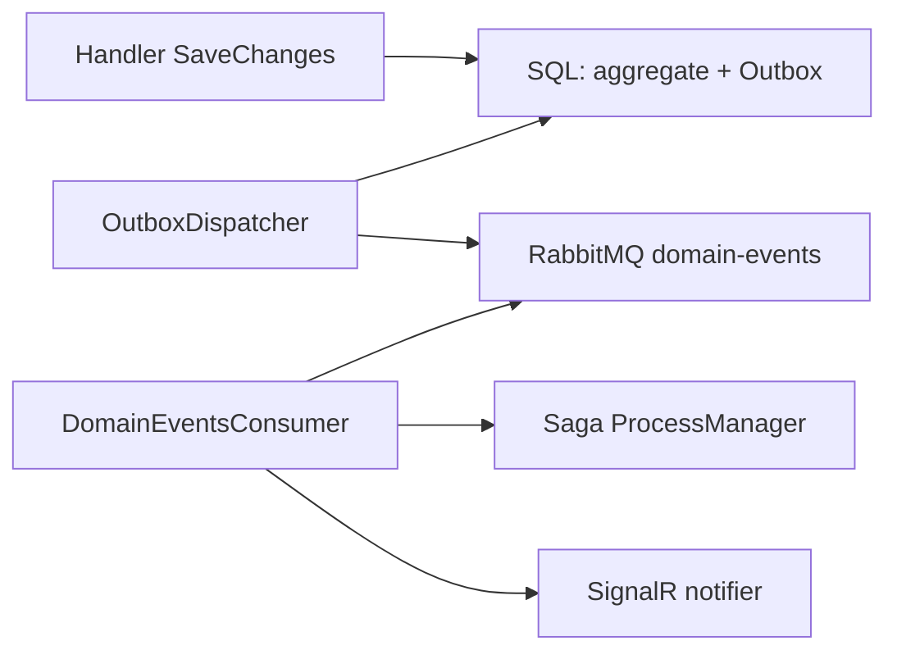
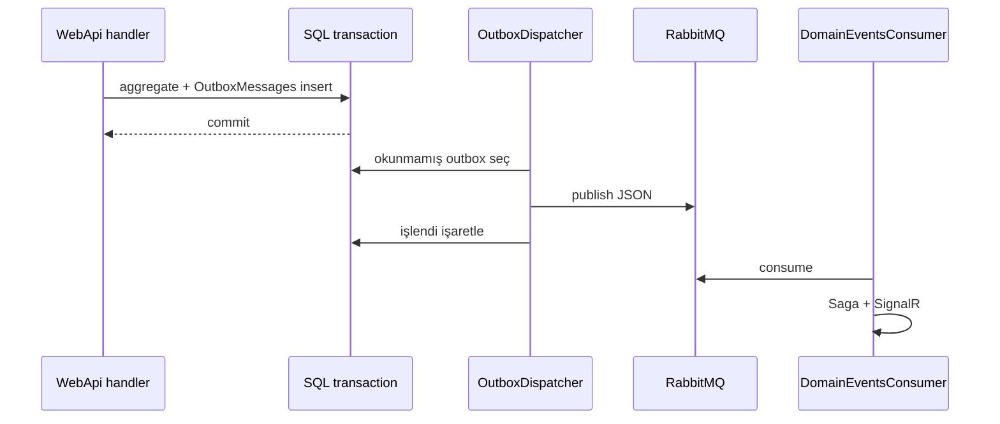

# 14 — Domain Events ve Transactional Outbox

[← Önceki](13-rabbitmq.md) · [İçindekiler](00-index.md) · [Sonraki →](15-saga.md)

İlgili: [13 RabbitMQ](13-rabbitmq.md) · [15 Saga](15-saga.md) · [16 SignalR](16-signalr.md)

## Bu nedir?

**Domain Event**: Aggregate içinde önemli bir şey oldu (`CreditApplicationApproved`).  
**Transactional Outbox**: Event’i **aynı SQL transaction** içinde `OutboxMessages` tablosuna yaz; ayrı bir worker sonra RabbitMQ’ya basar. Böylece “DB kayıtlı / kuyruk boş” veya tam tersi **dual-write** yarışı azalır.

**Benzetme:** Banka şubesinde müşteri işlemi ve “müşteriye gidecek mektup” aynı **tek zarf** içinde kasaya gider; kurye (dispatcher) zarfı sonradan postaya (RabbitMQ) verir. Kasa defteri ile kurye eli birbirinden kopmaz.



## Bu projede ne işe yarar?

Kredi create / approve / reject / cancel sonrası güvenilir yayın → Saga güncelleme + SignalR toast + decision-letter tetikleyicileri.

## Ne zaman eklendi?

**Faz 6**.

## Temel kavramlar

| Kavram | Anlamı |
|--------|--------|
| **IDomainEvent** | Olay sözleşmesi (tip + payload) |
| **Outbox row** | Henüz publish edilmemiş olay kaydı |
| **Dispatcher** | Periyodik okuyup kuyruğa basan hosted service |
| **Dual-write problem** | İki depolama yeri aynı anda güncellenemezse tutarsızlık |
| **At-least-once** | Kuyruk aynı mesajı iki kez verebilir → consumer idempotent olmalı |
| **ProcessedOnUtc** | Satırın kuyruğa basıldığını işaretlemek |



## Komutlar

Özel CLI yok. Gözlem:

```powershell
cd infra
docker compose --env-file .env logs -f webapi
```

Onay/red yaptıktan sonra logda `Outbox` veya `DomainEvents` satırlarını ara.

SQL (lab bağlantısı ile SSMS veya `sqlcmd`):

```sql
SELECT TOP 20 Id, Type, ProcessedOnUtc, OccurredOnUtc
FROM OutboxMessages
ORDER BY OccurredOnUtc DESC;
```

**Beklenen:** Yeni olaydan kısa süre sonra `ProcessedOnUtc` dolar; sürekli `NULL` kalıyorsa dispatcher veya RabbitMQ sorunu.

```powershell
# RabbitMQ kuyruk derinliği
# UI http://localhost:15672 → domain-events → Ready artıp azalmalı
docker compose --env-file .env exec rabbitmq rabbitmq-diagnostics -q ping
```

### Ne kontrol edilir?

| Kontrol | Nasıl | İyi görünüm |
|---------|-------|-------------|
| Outbox işlendi | SQL `ProcessedOnUtc` | approve sonrası dakikalar içinde dolu |
| Kuyruk akışı | Rabbit UI `domain-events` | Ready spike → düşer |
| Consumer | Queue Consumers ≥ 1 | WebApi healthy |
| UI geri bildirim | SignalR toast | Müşteri/personel anında bilgi |

### Felaket / kurtarma (lab)

| Durum | Yol |
|-------|-----|
| Outbox birikiyor, `ProcessedOnUtc` NULL | Rabbit down → `up -d rabbitmq webapi` |
| Duplicate Saga adımı | Idempotent handler; unit testleri çalıştır |
| Mesaj formatı bozuk | `logs webapi` exception; tip adı JSON ile uyumlu mu? |

```powershell
dotnet test tests/Application.UnitTests/Application.UnitTests.csproj --filter "FullyQualifiedName~Outbox"
```

## Sınıflar, metotlar, paketler

| İsim | Rol |
|------|-----|
| `CreditApplicationApproved` vb. | Domain event tipleri |
| `OutboxMessage` entity | Tablo satırı |
| `OutboxDispatcherHostedService` | Publish döngüsü |
| `DomainEventsConsumerHostedService` | Consume → saga + SignalR |
| Aggregate `Approve(...)` | Event üretir + outbox’a yazılır |

## Repoda nerede?

```
src/Domain/Events/
src/Persistence/…Outbox…
src/WebApi/…/Outbox…
src/WebApi/Modules/Notification/Messaging/DomainEventsConsumerHostedService.cs
```

## Mini akış

Handler SaveChanges (aggregate + outbox) → Dispatcher publish → RabbitMQ `domain-events` → Consumer → ProcessManager + SignalR `NotifyAsync` (+ decision-letter publish branch).

Ekran (RabbitMQ kuyrukları):


## Yeni başlayan lab

1. `docker compose up -d sqlserver rabbitmq webapi client`
2. Personel ile başvuruyu **onayla** veya **reddet**.
3. RabbitMQ UI → `domain-events` → Ready sayısının kısa sürede düştüğünü gör.
4. SQL’de son outbox satırında `ProcessedOnUtc` dolmuş mu bak.
5. Müşteri tarayıcısında toast’un geldiğini doğrula (SignalR — bölüm 16).

## Sık yapılan hatalar

- Olayı yalnızca RabbitMQ’ya basıp SQL commit’ten **sonra** publish etmek → crash’ta veri kaybı  
- Outbox satırını işaretlemeden kuyruğa basmak → tekrarlı mesaj (çoğu zaman tolere edilir ama Saga’da dikkat)  
- Event tip adını rename edip eski JSON’ların consumer’da kalması  
- Outbox dispatcher’ı unutup “SignalR neden çalışmıyor?” diye Hub’a bakmak  

## Nerede işe yarar?

- [ ] Onay/red sonrası outbox işleniyor (`ProcessedOnUtc`)  
- [ ] `domain-events` kuyruğu tıkanmıyor  
- [ ] Saga tablosu olayla güncelleniyor  
- [ ] SignalR toast outbox zincirinin sonunda geliyor
