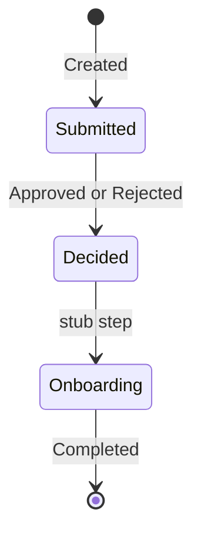
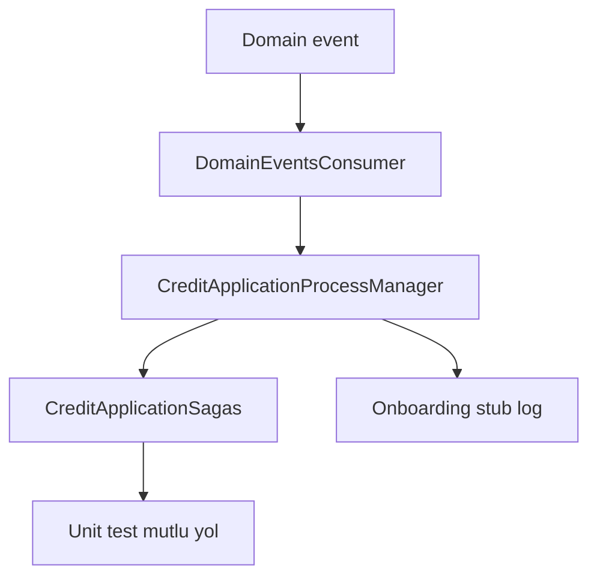

# 15 — Saga / Process Manager

[← Önceki](14-outbox-events.md) · [İçindekiler](00-index.md) · [Sonraki →](16-signalr.md)

İlgili: [14 Outbox](14-outbox-events.md) · [16 SignalR](16-signalr.md)

## Bu nedir?

**Saga / Process Manager**: Uzun süren iş sürecinin **durum makinesi**. Tek transaction’da bitmeyen adımları (oluştu → karar → onboarding stub) sırayla izler; her domain event geldiğinde “şimdi hangi adımdayız?” sorusuna cevap verir.

**Benzetme:** Pasaport başvurusu — form geldi, inceleme bitti, kart basımı; her aşama damga vurulur. BankApp’te damgalar `CreditApplicationSagas` tablosunda.



## Bu projede ne işe yarar?

`CreditApplicationSagas` tablosu + `CreditApplicationProcessManager`: kredi başvurusunun yaşam döngüsü orkestrasyonu (eğitim stub’ları dahil). Outbox consumer her ilgili event’te process manager’ı çağırır.

## Ne zaman eklendi?

**Faz 6**.

## Temel kavramlar

| Kavram | Anlamı |
|--------|--------|
| **Orchestration** | Merkezi yönetici adımları sırayla yönetir |
| **State** | Sürecin bulunduğu adım (`Submitted`, `Decided`, …) |
| **Compensation** | (İleri seviye) geri alma; lab’de stub odaklı |
| **Idempotent handler** | Aynı event iki kez gelse state bozulmaz |
| **Correlation** | Saga satırı `CreditApplicationId` ile aggregate’a bağlı |



## Komutlar

CLI yok; unit testlerle doğrulanır:

```powershell
dotnet test tests/Application.UnitTests/Application.UnitTests.csproj --filter "FullyQualifiedName~Saga"
```

Beklenen: yeşil testler — özellikle approve/reject geçişleri ve duplicate event senaryoları.

```powershell
# Entegrasyon: tam zincir (Outbox + consumer + saga)
dotnet test tests/WebApi.IntegrationTests/WebApi.IntegrationTests.csproj --filter "FullyQualifiedName~Credit"
```

Lab’de SQL ile saga satırı:

```sql
SELECT TOP 10 CreditApplicationId, State, UpdatedOnUtc
FROM CreditApplicationSagas
ORDER BY UpdatedOnUtc DESC;
```

## Sınıflar, metotlar, paketler

| İsim | Rol |
|------|-----|
| `CreditApplicationProcessManager` | Event’e göre state geçişi |
| `CreditApplicationSaga` entity | Kalıcı süreç durumu |
| Consumer içinden çağrı | Outbox event sonrası |
| Unit test sınıfları | Mutlu yol + idempotency |

## Repoda nerede?

```
src/Application/Modules/Credit/Sagas/
src/Domain/… (saga entity / states)
tests/Application.UnitTests/…Saga…
```

## Mini akış

Created event → saga “Submitted” → Approved event → `Decided` → onboarding stub → `Completed` (testlerle sabitlenmiş mutlu yol). Reject event’i de `Decided`’a götürür (onaylı değil).

## Yeni başlayan lab

1. Yeni müşteri başvurusu oluştur → SQL’de saga satırı `Submitted` görünsün.
2. Personel onaylasın → state `Decided` veya sonraki stub adımına geçsin.
3. Aynı approve event’ini test ortamında ikinci kez simüle eden unit testi oku — state çift artmıyor.
4. `dotnet test --filter Saga` çalıştır → hepsi geçsin.
5. Seq’te onboarding stub log satırını ara (varsa).

## Sık yapılan hatalar

- State geçişini HTTP handler içinde yapıp Outbox consumer’ı atlamak → dağıtık ortamda tutarsızlık  
- Idempotency düşünmeden “her event’te +1 counter” yazmak  
- Saga tablosunu UI’dan doğrudan düzenleyip testleri yanıltmak  
- Reject ve Approve için aynı son state adını kullanıp iş kuralını karıştırmak  

## Nerede işe yarar?

- [ ] Yeni başvuruda saga kaydı oluşuyor  
- [ ] Onay/red sonrası state güncelleniyor  
- [ ] Saga unit testleri yeşil  
- [ ] Duplicate event senaryosu bozmuyor (test + log)
