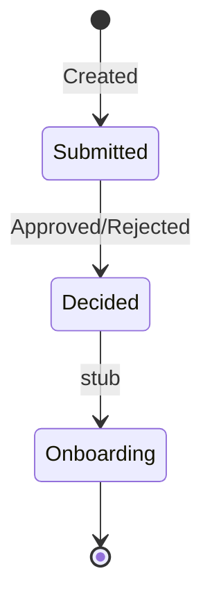

# 15 — Saga / Process Manager

[← Önceki](14-outbox-events.md) · [İçindekiler](00-index.md) · [Sonraki →](16-signalr.md)

## Bu nedir?

**Saga / Process Manager**: Uzun süren iş sürecinin durum makinesi.  
Tek transaction’da bitmeyen adımları (oluştu → karar → onboarding stub) sırayla izler.



## Bu projede ne işe yarar?

`CreditApplicationSagas` tablosu + `CreditApplicationProcessManager`: kredi başvurusunun yaşam döngüsü orkestrasyonu (eğitim stub’ları dahil).

## Ne zaman eklendi?

**Faz 6**.

## Temel kavramlar

| Kavram | Anlamı |
|--------|--------|
| **Orchestration** | Merkezi yönetici adımları yönetir |
| **State** | Sürecin bulunduğu adım |
| **Compensation** | (İleri seviye) geri alma; burada stub odaklı |
| **Idempotent handler** | Aynı event iki kez gelse bozulmama |

## Komutlar

CLI yok; unit testlerle doğrulanır:

```powershell
dotnet test --filter "FullyQualifiedName~Saga"
```

## Sınıflar, metotlar, paketler

| İsim | Rol |
|------|-----|
| `CreditApplicationProcessManager` | Event’e göre state geçişi |
| `CreditApplicationSaga` entity | Kalıcı süreç durumu |
| Consumer içinden çağrı | Outbox event sonrası |

## Repoda nerede?

```
src/Application/Modules/Credit/Sagas/
src/Domain/… (saga entity / states)
tests/Application.UnitTests/…Saga…
```

## Mini akış

Created event → saga “Created” → Approved event → karar state → onboarding stub → Completed (testlerle sabitlenmiş mutlu yol).
