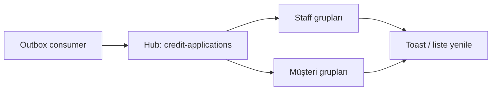
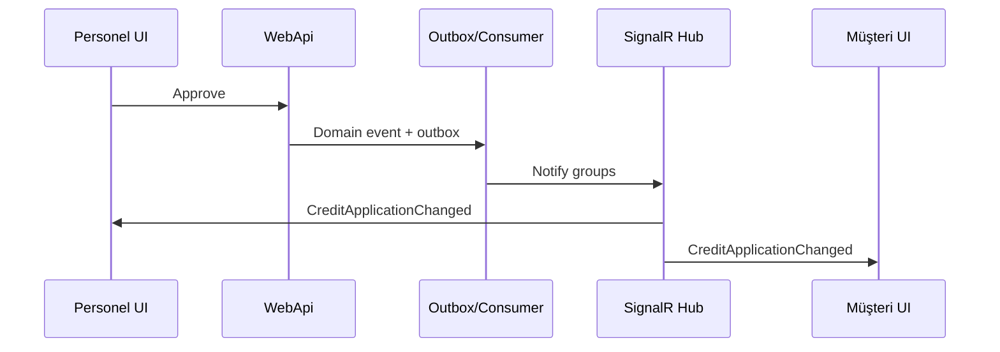

# 16 — SignalR

[← Önceki](15-saga.md) · [İçindekiler](00-index.md) · [Sonraki →](17-modular-monolith.md)

## Bu nedir?

**SignalR**, sunucunun tarayıcıya **anında** mesaj göndermesini sağlar (çoğunlukla WebSocket).  
Sayfa yenilemeden toast, rozet veya liste güncellemesi yapılır.

**Benzetme:** Klasik HTTP “soru–cevap mektubu” gibidir; SignalR ise açık kalan bir **telefon hattı** — banka (API) müşteriye (tarayıcıya) istediği an arayabilir.



## Bu projede ne işe yarar?

- Hub yolu: `/hubs/credit-applications`
- Outbox consumer olay işleyince staff + ilgili müşteri gruplarına `CreditApplicationChanged` basar
- Payload’da tutar + **currencyCode** vardır → UI `formatMoney` ile doğru sembol gösterir

Ekran örneği (personel toast / canlı güncelleme): [bank-employee screenshots](../../screenshots/bank-employee.en.md)

## Ne zaman eklendi?

**Faz 6** (Modular Monolith anlatımından önce uygulanmıştı).

## Temel kavramlar

| Kavram | Anlamı |
|--------|--------|
| **Hub** | İstemci–sunucu sözleşme noktası (hangi metoda abone / hangi event gelir) |
| **Group** | “Bu şubedeki personel” gibi yayın kümesi |
| **access_token** | WebSocket bağlanırken JWT (query veya header) |
| **Reconnect** | Hat kopunca otomatik yeniden bağlanma |



## Komutlar

```powershell
# İstemci SignalR paketi
cd client
npm install @microsoft/signalr
```

Doğrulama: Browser DevTools → **Network** → **WS** filtresi → `credit-applications` hub çerçevesi.

## Sınıflar, metotlar, paketler

| İsim | Rol |
|------|-----|
| Credit applications hub (WebApi) | Bağlantı / grup |
| `ICreditApplicationRealtimeNotifier` | Publish soyutlaması |
| `CreditApplicationChangedMessage` | Payload (Amount, CurrencyCode) |
| `useCreditApplicationRealtime` | React hook + toast |

Paketler: ASP.NET Core SignalR (sunucu), `@microsoft/signalr` (istemci).

## Repoda nerede?

```
src/WebApi/Modules/Notification/Realtime/
client/src/realtime/
```

## Mini akış

Personel onaylar → Outbox → Consumer → Hub grupları → müşteri tarayıcısında success toast + `formatMoney(currencyCode)`.

## Yeni başlayan lab

1. Compose ile API + client ayakta olsun.
2. İki tarayıcı: biri personel, biri müşteri (aynı başvuruya bakabilen hesaplar).
3. Personel başvuruyu onayla/reddet.
4. Müşteri sekmesinde toast’un geldiğini gör (F5 yok).
5. DevTools → WS’de mesajı incele.

## Sık yapılan hatalar

- JWT olmadan hub’a bağlanmaya çalışmak → 401 / bağlantı düşer  
- Sadece HTTP’ye bakıp WS’i kaçırmak  
- `currencyCode` yok sayıp tutarı yanlış sembolle göstermek  

## Nerede işe yarar?

- [ ] Onay/red sonrası toast geliyor  
- [ ] WS bağlantısı DevTools’ta görünüyor  
- [ ] Müşteri + personel grupları doğru besleniyor  
