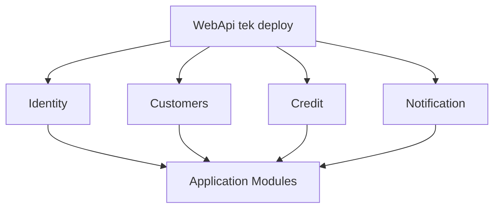
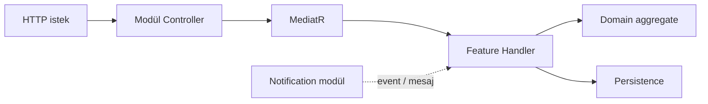

# 17 — Modular Monolith

[← Önceki](16-signalr.md) · [İçindekiler](00-index.md) · [Sonraki →](18-otel-observability.md)

## Bu nedir?

**Modular Monolith**: Tek deploy / genelde tek veritabanı; kod **modül sınırlarıyla** ayrılır (Identity, Credit, …). Mikroservis ağı ve dağıtık transaction maliyeti yok; bounded context disiplini var.

**Benzetme:** Aynı binada farklı **kat planları** — her kat (modül) kendi kurallarıyla çalışır, ortak merdiven (Domain/Core) vardır ama komşu kata doğrudan iç kapı açmazsın; koridor (Application interface) üzerinden gidersin.



## Bu projede ne işe yarar?

Modüller: **Identity**, **Customers**, **Credit**, **Notification** — hem `Application/Modules` hem `WebApi/Modules`. şube özelliği → hangi context? (Customers vs Credit branch kuralları) → o modülün `Features` altına CQRS dosyaları → WebApi controller aynı modülde → testler modül klasöründe.

## Yeni başlayan labözellik eklerken “hangi iş dili?” sorusu klasör seçimini belirler.

## Ne zaman eklendi?

**Faz 6**.

## Temel kavramlar

| Kavram | Anlamı |
|--------|--------|
| **Bounded context** | Bir iş dilinin sınırı (kredi vs müşteri) |
| **Module** | Klasör + DI registration + controller grubu |
| **Shared kernel** | Modüllerin ortak ince çekirdeği (`Domain`, `Application` cross-cutting) |
| **Feature slice** | CQRS handler + validator + controller birlikte |
| **Host module** | WebApi’de modüle özel hosted service kaydı |



## Komutlar

Yapısal bir pattern; doğrulama:

```powershell
dotnet build BankApp.slnx
```

şube özelliği → hangi context? (Customers vs Credit branch kuralları) → o modülün `Features` altına CQRS dosyaları → WebApi controller aynı modülde → testler modül klasöründe.

## Yeni başlayan labfeature eklerken doğru modül klasörüne koy (`Credit` mi `Identity` mi?). Mimari notlar:

```powershell
# Repodaki kararlar (okuma)
# docs/architecture-notes.tr.md
```

Modül sınırı ihlali aramak (kalıp örnek — Credit handler’da Identity persistence’a doğrudan erişim olmamalı):

```powershell
dotnet build BankApp.slnx --warnaserror
```

## Sınıflar, metotlar, paketler

| İsim | Rol |
|------|-----|
| `AddApplicationModules()` | Modül DI kayıtları |
| `WebApi/Modules/*/Controllers` | HTTP uçları |
| `Application/Modules/*/Features` | CQRS use case’ler |
| Notification hosted services | Messaging / realtime |

## Repoda nerede?

```
src/Application/Modules/
src/WebApi/Modules/
docs/architecture-notes.tr.md
```

## Mini akış

şube özelliği → hangi context? (Customers vs Credit branch kuralları) → o modülün `Features` altına CQRS dosyaları → WebApi controller aynı modülde → testler modül klasöründe.

## Yeni başlayan lab“şube” özelliği → hangi context? (Customers vs Credit branch kuralları) → o modülün `Features` altına CQRS dosyaları → WebApi controller aynı modülde → testler modül klasöründe.

## şube özelliği → hangi context? (Customers vs Credit branch kuralları) → o modülün `Features` altına CQRS dosyaları → WebApi controller aynı modülde → testler modül klasöründe.

## Yeni başlayan labbaşlayan lab

1. `src/Application/Modules/` altında dört modül klasörünü gez.
2. `src/WebApi/Modules/Credit/` içinde bir controller aç — hangi MediatR komutlarını çağırdığına bak.
3. Notification’daki `HostedService` kaydını `NotificationHostModule` içinde bul.
4. Yanlışlıkla `Credit` handler’ından `Identity` entity’sine doğrudan `DbSet` erişimi olup olmadığını kod aramasıyla kontrol et (`grep` / IDE).
5. `dotnet build` ile solution’un modüller arası referanslarının derlendiğini doğrula.

## Sık yapılan hatalar

- Tüm kodu `WebApi` altına yığmak — Application katmanı boş kalır  
- Modüller arası **doğrudan** concrete sınıf çağrısı (interface/event ile gevşet)  
- Controller içinde iş kuralı yazmak — MediatR handler’a taşı  
- “Tek DB” = “tek tablo her yere” sanmak — aggregate sınırlarına uy  

## Nerede işe yarar?

- [ ] şube özelliği → hangi context? (Customers vs Credit branch kuralları) → o modülün `Features` altına CQRS dosyaları → WebApi controller aynı modülde → testler modül klasöründe.

## Yeni başlayan labfeature doğru `Modules/{Name}/Features` altında  
- [ ] `dotnet build BankApp.slnx` hatasız  
- [ ] Controller ince, handler kalın (CQRS)  
- [ ] Notification mesajlaşma Credit’dan kopuk modülde
