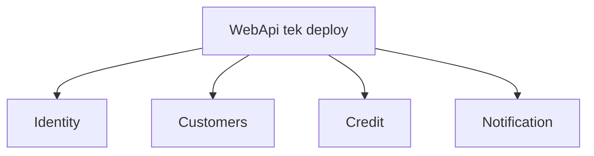

# 17 — Modular Monolith

[← Önceki](16-signalr.md) · [İçindekiler](00-index.md) · [Sonraki →](18-otel-observability.md)

## Bu nedir?

**Modular Monolith**: Tek deploy / genelde tek DB; kod **modül sınırlarıyla** ayrılır. Mikroservis karmaşası olmadan bounded context disiplini.



## Bu projede ne işe yarar?

Modüller: **Identity**, **Customers**, **Credit**, **Notification** — hem `Application/Modules` hem `WebApi/Modules`.

## Ne zaman eklendi?

**Faz 6**.

## Temel kavramlar

| Kavram | Anlamı |
|--------|--------|
| **Bounded context** | Bir iş dilinin sınırı |
| **Module** | Klasör + registration + controller grubu |
| **Shared kernel** | Modüllerin ortak kullandığı ince çekirdek (Domain/Core) |

## Komutlar

Yapısal bir pattern; CLI:

```powershell
dotnet build BankApp.slnx
```

Yeni feature eklerken doğru modül klasörüne koy (`Credit` mi `Identity` mi?).

## Sınıflar, metotlar, paketler

| İsim | Rol |
|------|-----|
| `AddApplicationModules()` | Modül DI kayıtları |
| `WebApi/Modules/*/Controllers` | HTTP uçları |
| Notification hosted services | Messaging / realtime |

## Repoda nerede?

```
src/Application/Modules/
src/WebApi/Modules/
docs/architecture-notes.tr.md
```

## Mini akış

Yeni “şube” özelliği → önce hangi context? (Customers vs Credit) → o modülün Features altına CQRS dosyaları → WebApi controller aynı modülde.
