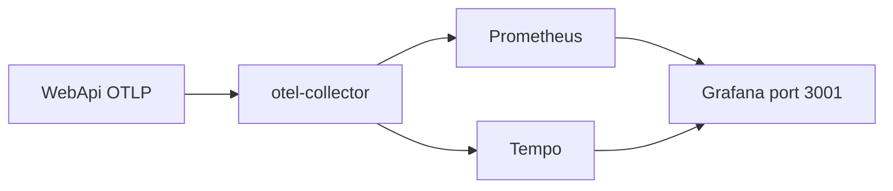
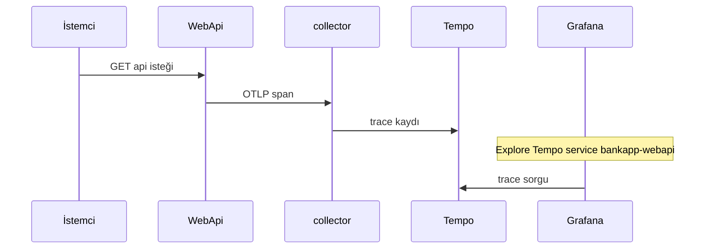

# 18 — OpenTelemetry, Prometheus, Grafana

[← Önceki](17-modular-monolith.md) · [İçindekiler](00-index.md) · [Sonraki →](19-vault-lab.md)

## Bu nedir?

**OpenTelemetry (OTel)**: Uygulamadan **trace / metric / (log köprüleri)** toplama standardı.  
**Prometheus**: Metric scrape / saklama.  
**Grafana**: Dashboard UI. Lab’de **Tempo** trace backend olarak kullanılır.  
**Seq** log için kalır (ayrı bölüm — bölüm 07).

**Benzetme:** OTel = güvenlik kamerası kaydı; Span = koridordaki her kapıda geçen süre; Prometheus = sayaç paneli; Grafana = hepsini tek ekranda izleyen **güvenlik odası**.



## Bu projede ne işe yarar?

WebApi OTLP ile collector’a gönderir → Prometheus / Tempo → Grafana `:3001` ile bakarsın.

## Ne zaman eklendi?

**Faz 6** (OTel dilimi).

## Temel kavramlar

| Kavram | Anlamı |
|--------|--------|
| **Trace / Span** | İstek yolculuğu ve adımları |
| **Metric** | Sayaç / histogram (HTTP süresi vb.) |
| **OTLP** | OTel export protokolü |
| **Collector** | Aracı (alır, işler, dağıtır) |
| **service.name** | Grafana/Tempo’da filtre: `bankapp-webapi` |



## Komutlar

```powershell
cd infra
docker compose --env-file .env up -d otel-collector prometheus grafana tempo

# Grafana http://localhost:3001  → admin / admin
# Prometheus http://localhost:9090
# OTLP (uygulama → collector) localhost:4317

docker compose --env-file .env ps otel-collector tempo prometheus grafana
curl -s http://localhost:9090/-/ready
curl -s -o NUL -w "%{http_code}`n" http://localhost:3001/api/health
```

Grafana’da hızlı tur:

1. Birkaç API isteği at (Scalar / client; `/health` genelde trace dışı).
2. **Dashboards → BankApp → BankApp HTTP (OTel)**.
3. **Explore → Tempo** → service `bankapp-webapi`.
4. **Explore → Prometheus** → örn. `up` veya HTTP duration metrikleri.
5. Seq’te aynı isteğin `TraceId` alanına bak.

Detaylı lab araç notları: [24 — Lab tools](24-lab-tools.md).

## Sınıflar, metotlar, paketler

| Paket | Rol |
|-------|-----|
| `OpenTelemetry.Extensions.Hosting` | Host |
| `OpenTelemetry.Instrumentation.AspNetCore` / `Http` / `Runtime` | Otomatik span/metric |
| `OpenTelemetry.Exporter.OpenTelemetryProtocol` | OTLP export |

Kayıt: WebApi DI / `Program` veya extension metodları.

## Repoda nerede?

```
src/WebApi/… OpenTelemetry setup
infra/docker-compose.yml
infra/otel/ (varsa collector config)
docs/assets/screenshots/en/Metrics on Grafana.png
```

## Mini akış

HTTP istek → AspNetCore instrumentation span → OTLP collector → Tempo/Prometheus → Grafana’da grafik.

## Yeni başlayan lab

1. `docker compose --env-file .env up -d otel-collector prometheus grafana tempo webapi`.
2. Birkaç API isteği at (Scalar veya client — `/health` çoğu zaman trace dışıdır; gerçek endpoint kullan).
3. Grafana http://localhost:3001 → admin / admin → **Dashboards → BankApp → BankApp HTTP (OTel)**.
4. **Explore → Tempo** → service `bankapp-webapi` → az önceki isteği bul.
5. Seq’te aynı isteğin log satırında `TraceId` var mı karşılaştır (korelasyon alıştırması).

## Sık yapılan hatalar

- Grafana’yı açmadan önce hiç trafik üretmemek — boş dashboard  
- Sadece `/health` çağırıp “trace yok” demek  
- Collector down iken WebApi loglarında OTLP hatasını görmezden gelmek  
- Prometheus `up` metriğini kontrol etmeden dashboard yorumlamak  

## Nerede işe yarar?

- [ ] `curl http://localhost:9090/-/ready` → 200  
- [ ] Grafana health 200  
- [ ] Tempo’da `bankapp-webapi` span’leri görünüyor  
- [ ] Seq TraceId ile trace eşleşebiliyor (lab)
