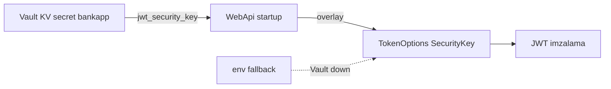
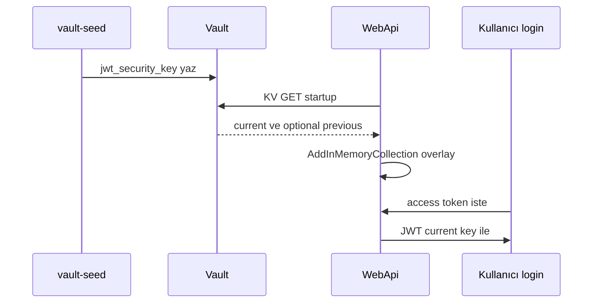

# 19 — HashiCorp Vault (lab) + WebApi overlay

[← Önceki](18-otel-observability.md) · [İçindekiler](00-index.md) · [Sonraki →](20-pdf-export.md)

İlgili: [06 JWT](06-jwt-rbac.md) · [24 Lab tools](24-lab-tools.md) · [09 Compose](09-docker-compose.md)

## Bu nedir?

**Vault**: Secret saklama. BankApp lab’inde Compose **dev-mode** Vault + `vault-seed` → KV path `secret/bankapp`.  
WebApi startup’ta opsiyonel olarak **JWT güvenlik anahtarını** Vault’tan okuyup `TokenOptions:SecurityKey` üzerine yazar.

**Benzetme:** Vault = **kasa dairesi**; overlay = kasadan çıkan anahtarın çalışma masasındaki kopyayla değiştirilmesi; `.env` fallback = kasa kapalıyken çekmecedeki yedek anahtar (sadece lab).



## Bu projede ne işe yarar?

- Secret’ların UI’da görülmesi (eğitim).
- Compose’ta `Vault__Enabled=true` iken JWT key Vault’tan gelir; Vault down ise `.env` / `TokenOptions__SecurityKey` fallback.
- SQL connection string hâlâ Compose env (basit tutmak için); sonraki dilimde genişletilebilir.

## Ne zaman eklendi?

Compose lab daha önce; **WebApi JWT overlay** güvenlik diliminde.

## Temel kavramlar

| Kavram | Anlamı |
|--------|--------|
| **KV v2** | `secret/data/{path}` HTTP API |
| **X-Vault-Token** | İstek header’ındaki token |
| **Overlay** | `AddInMemoryCollection` ile config üstüne yazma |
| **Dev mode** | Üretim değil; unseal/raft yok; veri ephemeral |
| **Root token** | Lab’de her şeye yetkili — prod anti-pattern |



## Komutlar

```powershell
cd infra

# Vault + seed job (seed bir kez secret yazar)
docker compose --env-file .env up -d vault
docker compose --env-file .env up vault-seed
# Kontrol: vault healthy; UI http://localhost:8200
# Token: .env içindeki VAULT_DEV_ROOT_TOKEN_ID (ör. bankapp-vault-root-token)
```

**Vault UI**

1. Method: **Token** → yapıştır `VAULT_DEV_ROOT_TOKEN_ID`.
2. Secrets → KV → `secret` → `bankapp` (veya seed path’i).
3. `jwt_security_key` alanını oku (değeri ekran görüntüsüne koyma).

```powershell
# CLI ile aynı secret (konteyner içi vault binary)
docker compose --env-file .env exec vault vault kv get secret/bankapp
# Beklenen: jwt_security_key satırı; hata → seed çalışmadı veya path yanlış
```

```powershell
# Vault durumu (dev mode’da seal bilgisi)
docker compose --env-file .env exec vault vault status

# WebApi overlay uygulandı mı?
docker compose --env-file .env logs webapi | Select-String -Pattern "Vault"
# Beklenen: "Vault overlay applied" veya fallback uyarısı
```

```powershell
# Host’tan UI / API kaba kontrol
curl -s -o NUL -w "%{http_code}`n" http://localhost:8200/ui/
curl -s -H "X-Vault-Token: bankapp-vault-root-token" http://localhost:8200/v1/secret/data/bankapp
# Token’ı kendi .env değerinle değiştir; 200 + JSON data
```

### Ne kontrol edilir?

| Kontrol | Nasıl | İyi görünüm |
|---------|-------|-------------|
| Vault up | `compose ps vault` | healthy / Up |
| Seed | `vault kv get secret/bankapp` | key dolu |
| Overlay | `logs webapi` + Vault | overlay applied |
| Fallback | Vault’u durdurup WebApi restart | `.env` key ile ayakta (lab) |

### Felaket / kurtarma (lab)

| Durum | Yol |
|-------|-----|
| UI “sealed” / boş (dev reset) | Dev Vault restart → **seed’i tekrar çalıştır** (`up vault-seed`) |
| kv get not found | Seed exit code / `logs vault-seed`; path `secret/bankapp` |
| WebApi 500 JWT / imza | Overlay yok + yanlış key uzunluğu; `.env` `TOKEN_SECURITY_KEY` ≥ 64 byte |
| Token unuttun | `infra/.env` → `VAULT_DEV_ROOT_TOKEN_ID` (örnek dosyada da var) |

```powershell
# Seed’i yeniden koştur (Vault ayaktayken)
docker compose --env-file .env up vault-seed

# Vault’u recreate + seed (lab secret’ları yenilenir)
docker compose --env-file .env up -d --force-recreate vault
docker compose --env-file .env up vault-seed
docker compose --env-file .env up -d --force-recreate webapi
```

**Dikkat / best practice:** Dev mode ≠ prod (Raft, policy, rotation). Root token’ı public issue’ya yapıştırma. SQL/Rabbit hâlâ Compose env — bilinçli sadeleştirme.

## Secret rotasyonu (lab dual-key) ve Raft HA (opsiyonel Compose)

Günlük BankApp yığını **dev-mode** Vault kullanır (`:8200`). **JWT dual-key** bu stack’te. **Raft HA** ayrı dosya: `docker-compose.vault-raft.yml` (port **8210/8211/8212** — çakışma yok).

| Konu | Lab’de durum | Üretimde |
|------|--------------|----------|
| **JWT rotasyon** | `jwt_security_key` + `jwt_security_key_previous`; WebApi imza=current, doğrulama=ikisi | Key id, kısa dual-key penceresi, rolling restart |
| **Raft / HA** | Opsiyonel 3-node Compose overlay | ≥3 node Raft, unseal, audit, TLS |
| **Policy** | Root token | AppRole + dar policy |

### Dual-key rotate (önerilen lab)

```powershell
cd infra

# Aktif key → previous; yeni aktif key yaz (mssql/rabbit alanları korunur)
docker compose --env-file .env exec `
  -e VAULT_TOKEN=bankapp-vault-root-token `
  vault /bin/sh /vault-rotate-jwt.sh

# WebApi Vault overlay’i yeniden okusun (--no-deps: vault-seed yeniden yazmasın)
docker compose --env-file .env up -d --force-recreate --no-deps webapi
```

**Kontrol:** `vault kv get secret/bankapp` → `jwt_security_key` ve `jwt_security_key_previous`; log’da `SecurityKey + Previous`.  
Eski (previous ile imzalı) access token hâlâ geçerli olmalı; yeni login current ile imzalanır.  
`vault-seed` artık secret varsa üzerine yazmaz (rotasyonu korur); yine de recreate’de `--no-deps` kullanmak güvenli alışkanlıktır.

İsteğe bağlı özel key:

```powershell
docker compose --env-file .env exec `
  -e VAULT_TOKEN=bankapp-vault-root-token `
  -e NEW_JWT_KEY="BankApp-Rotated-Jwt-Key-Replace-Me-With-At-Least-64-Characters-ABCDEF" `
  vault /bin/sh /vault-rotate-jwt.sh
```

### Daha yıkıcı (eski yol)

```powershell
docker compose --env-file .env up -d --force-recreate vault
docker compose --env-file .env up vault-seed
docker compose --env-file .env up -d --force-recreate webapi
```

### Raft HA lab (opsiyonel — günlük stack’i bozmaz)

```powershell
cd infra

# 3 node (UI: http://localhost:8210 )
docker compose -f docker-compose.vault-raft.yml up -d

# Leader init + unseal (root token / unseal çıktıda)
docker compose -f docker-compose.vault-raft.yml exec vault-raft-1 /bin/sh /vault-raft-init.sh
```

Peer join (node 2 / 3 — önce leader unseal edilmiş olmalı):

```powershell
docker compose -f docker-compose.vault-raft.yml exec vault-raft-2 `
  vault operator raft join http://vault-raft-1:8200
docker compose -f docker-compose.vault-raft.yml exec vault-raft-2 `
  vault operator unseal <UNSEAL>
# aynı vault-raft-3 için
docker compose -f docker-compose.vault-raft.yml exec -e VAULT_TOKEN=<ROOT> vault-raft-1 `
  vault operator raft list-peers
```

**Kontrol:** `list-peers` 3 satır (leader + 2 follower); UI Token ile `:8210`.  
**Not:** Varsayılan WebApi hâlâ `vault:8200` (dev). Raft’ı BankApp’e bağlamak ayrı deney (env `Vault__Address=http://host.docker.internal:8210`) — günlük lab için gerekli değil.  
**Lab notu:** Raft data `/tmp/vault-raft-data` (container ephemeral — recreate = yeniden init). Prod’da kalıcı volume + TLS kullan.  
**Yıkıcı:** `docker compose -f docker-compose.vault-raft.yml down` (tmp data kaybolur).

## Sınıflar, metotlar, paketler

| İsim | Rol |
|------|-----|
| `VaultOptions` | Enabled, Address, Token, MountPath, SecretPath |
| `ApplyVaultSecretsAsync` | HTTP GET KV → `jwt_security_key` (+ optional previous) → config overlay |
| `TokenOptions.SecurityKeyPrevious` | Dual-key validation window |
| `TokenSigningKeyFactory` | İmza: current; doğrulama: current + previous |
| `vault-rotate-jwt.sh` | KV rotate (previous ← current) |
| `vault-raft-init.sh` | Raft leader init/unseal (opsiyonel HA) |
| `Program.cs` | DI’dan önce `await builder.Configuration.ApplyVaultSecretsAsync()` |

Paket: ek Vault SDK yok — `HttpClient` + JSON.

## Repoda nerede?

```
src/WebApi/Configuration/VaultOptions.cs
src/WebApi/Configuration/VaultConfigurationExtensions.cs
src/WebApi/Program.cs
src/WebApi/appsettings.json          # Vault:Enabled=false (local)
infra/docker-compose.yml             # Vault__Enabled=true (dev)
infra/docker-compose.vault-raft.yml  # opsiyonel 3-node Raft
infra/vault-raft/config-node*.hcl
infra/scripts/vault-seed.sh
infra/scripts/vault-rotate-jwt.sh
infra/scripts/vault-raft-init.sh
infra/.env.example
```

## Mini akış

vault-seed `jwt_security_key` yazar → WebApi start → overlay → JWT imza current key ile.  
Rotate script → previous + new current → WebApi recreate → eski token previous ile doğrulanır, yeni login current ile.

## Yeni başlayan lab

1. `docker compose up -d vault` → `docker compose up vault-seed` → UI :8200 token ile giriş.
2. `vault kv get secret/bankapp` → `jwt_security_key` satırını gör (değeri paylaşma).
3. WebApi’yi başlat → logda `Vault overlay applied` ara.
4. Login ol → geçerli JWT al.
5. `vault-rotate-jwt.sh` çalıştır → WebApi recreate → **eski** token hâlâ çalışıyor mu, **yeni** login farklı key ile mi test et.

## Sık yapılan hatalar

- Dev Vault’u prod Raft ile karıştırmak — günlük stack `:8200` dev mode  
- Rotate sonrası `vault-seed` ile secret’ı ezmek — `--no-deps webapi` ve seed idempotency  
- `TOKEN_SECURITY_KEY` 64 byte altı → JWT handler hata  
- Root token’ı issue/screenshot’a yapıştırmak  

## Nerede işe yarar?

- [ ] Vault healthy + seed path dolu  
- [ ] WebApi overlay veya bilinçli fallback logu  
- [ ] Login JWT geçerli  
- [ ] Rotate sonrası dual-key penceresi (previous + current) test edildi
