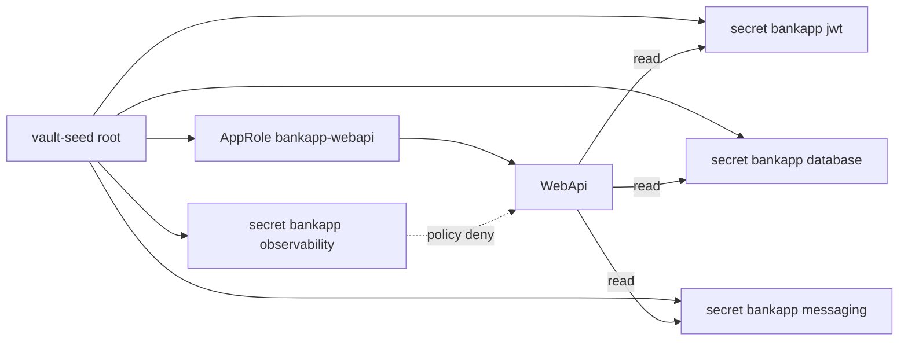
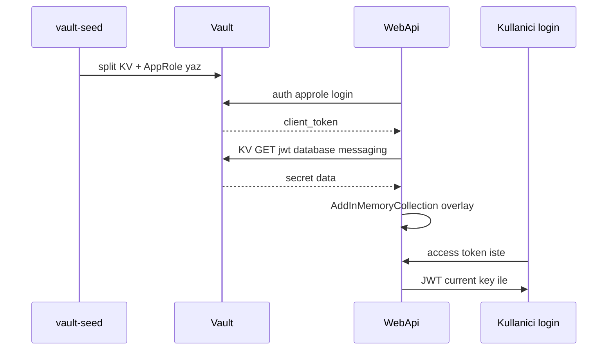

# 19 — HashiCorp Vault (lab) + WebApi overlay

[← Önceki](18-otel-observability.md) · [İçindekiler](00-index.md) · [Sonraki →](20-pdf-export.md)

İlgili: [06 JWT](06-jwt-rbac.md) · [24 Lab tools](24-lab-tools.md) · [09 Compose](09-docker-compose.md)

## Bu nedir?

**Vault**: Secret saklama. BankApp lab’inde Compose **dev-mode** Vault + `vault-seed` ayrılmış KV path’ler yazar ve **AppRole** kimlik bilgisi üretir.  
WebApi **root token kullanmaz**; AppRole ile login olup JWT + SQL şifresi + RabbitMQ kimlik bilgisini okur (`FailClosed=true` iken Vault hatası startup’ı düşürür).

**Benzetme:** Vault = **kasa dairesi**; AppRole = personele verilen **sınırlı anahtar kartı** (yalnız kendi dolapları); root token = yönetici master anahtarı (yalnız seed/UI); observability path = güvenlik kamerası dolabı (personel kartı açamaz).



## Bu projede ne işe yarar?

- Secret’ların path bazlı ayrılması + UI’da görülmesi (eğitim).
- Compose’ta AppRole + `FailClosed=true`: JWT, SQL `Password`, RabbitMQ user/password Vault’tan overlay.
- Observability admin secret’ları Vault’ta durur; WebApi policy **okuyamaz**.
- SQL/Rabbit/Grafana/Keycloak **konteynerleri** hâlâ Compose `.env` ile ayağa kalkar (Vault Agent kapsam dışı).

## Ne zaman eklendi?

Compose lab + JWT overlay önce; **AppRole + split path + FailClosed** güvenlik diliminde.

## Temel kavramlar

| Kavram | Anlamı |
|--------|--------|
| **KV v2** | `secret/data/{path}` HTTP API |
| **AppRole** | `role_id` + `secret_id` → kısa ömürlü client token |
| **Policy** | Hangi path’lere read/write — least privilege |
| **FailClosed** | Vault/AppRole başarısızsa uygulama ayağa kalkmaz |
| **Overlay** | `AddInMemoryCollection` ile config üstüne yazma |
| **Dev mode** | Üretim değil; unseal/raft yok; veri ephemeral |
| **Root token** | Yalnız bootstrap — WebApi’ye verilmez |



## Komutlar

```powershell
cd infra

# Vault + seed job (seed bir kez secret yazar)
docker compose --env-file .env up -d vault
docker compose --env-file .env up vault-seed
# Kontrol: vault healthy; UI http://localhost:8200
# Token: .env içindeki VAULT_DEV_ROOT_TOKEN_ID (ör. bankapp-vault-root-token)
```

**Vault UI**

1. Method: **Token** → yapıştır `VAULT_DEV_ROOT_TOKEN_ID` (yalnız operatör).
2. Secrets → KV → `secret` → `bankapp` → `jwt` / `database` / `messaging` / `observability`.
3. `jwt` altında `jwt_security_key` alanını oku (değeri ekran görüntüsüne koyma).

```powershell
# Split path’ler
docker compose --env-file .env exec vault vault kv get secret/bankapp/jwt
docker compose --env-file .env exec vault vault kv get secret/bankapp/database
docker compose --env-file .env exec vault vault kv get secret/bankapp/messaging
docker compose --env-file .env exec vault vault kv get secret/bankapp/observability
```

```powershell
# Vault durumu (dev mode’da seal bilgisi)
docker compose --env-file .env exec vault vault status

# WebApi AppRole overlay
docker compose --env-file .env logs webapi | Select-String -Pattern "Vault"
# Beklenen: "Vault overlay applied via AppRole"
```

```powershell
# Policy deny smoke (AppRole token ile observability → 403)
$roleId = docker compose --env-file .env exec -T webapi cat /vault-approle/role_id
$secretId = docker compose --env-file .env exec -T webapi cat /vault-approle/secret_id
# Login + kv get observability docs için root token kullan; AppRole ile denemek learning lab adımı
```

### Ne kontrol edilir?

| Kontrol | Nasıl | İyi görünüm |
|---------|-------|-------------|
| Vault up | `compose ps vault` | healthy / Up |
| Seed paths | `kv get` jwt/database/messaging/observability | dolu |
| AppRole files | volume / WebApi `/vault-approle` | role_id + secret_id |
| Overlay | `logs webapi` | AppRole overlay applied |
| FailClosed | Vault down + WebApi recreate | WebApi ayağa kalkmaz / restart |

### Felaket / kurtarma (lab)

| Durum | Yol |
|-------|-----|
| UI “sealed” / boş (dev reset) | Vault recreate → **seed** → **webapi recreate** (yeni secret_id) |
| kv get not found | `logs vault-seed`; path `secret/bankapp/jwt` vb. |
| WebApi FailClosed loop | Seed tamamlandı mı? Approle volume mount? |
| JWT / imza | `TOKEN_SECURITY_KEY` ≥ 64 byte; jwt path dolu |
| Root token unuttun | `infra/.env` → `VAULT_DEV_ROOT_TOKEN_ID` |

```powershell
# Seed’i yeniden koştur (yeni AppRole secret_id) + WebApi
docker compose --env-file .env up vault-seed
docker compose --env-file .env up -d --force-recreate --no-deps webapi

# Vault’u recreate + seed
docker compose --env-file .env up -d --force-recreate vault
docker compose --env-file .env up vault-seed
docker compose --env-file .env up -d --force-recreate --no-deps webapi
```

**Dikkat / best practice:** Dev mode ≠ prod (Raft, TLS, audit). Root token’ı WebApi’ye veya public issue’ya koyma. Konteyner bootstrap hâlâ Compose `.env`.

## Secret rotasyonu (lab dual-key) ve Raft HA (opsiyonel Compose)

Günlük BankApp yığını **dev-mode** Vault kullanır (`:8200`). **JWT dual-key** bu stack’te. **Raft HA** ayrı dosya: `docker-compose.vault-raft.yml` (port **8210/8211/8212** — çakışma yok).

| Konu | Lab’de durum | Üretimde |
|------|--------------|----------|
| **JWT rotasyon** | `secret/bankapp/jwt` dual-key; WebApi imza=current, doğrulama=ikisi | Key id, kısa dual-key penceresi, rolling restart |
| **Auth** | AppRole + dar policy (Compose) | K8s Auth / AppRole / JWT auth + CSI / Agent |
| **Raft / HA** | Opsiyonel 3-node Compose overlay | ≥3 node Raft, unseal, audit, TLS |

### Dual-key rotate (önerilen lab)

```powershell
cd infra

# Yalnız secret/bankapp/jwt güncellenir (database/messaging dokunulmaz)
docker compose --env-file .env exec `
  -e VAULT_TOKEN=bankapp-vault-root-token `
  vault /bin/sh /vault-rotate-jwt.sh

# WebApi Vault overlay’i yeniden okusun
docker compose --env-file .env up -d --force-recreate --no-deps webapi
```

**Kontrol:** `vault kv get secret/bankapp/jwt` → `jwt_security_key` ve `jwt_security_key_previous`; log’da `SecurityKey + Previous`.  
Eski (previous ile imzalı) access token hâlâ geçerli olmalı; yeni login current ile imzalanır.  
`vault-seed` jwt/database/messaging varsa ezmez (rotasyonu korur); observability her seed’de env’den yenilenebilir.

İsteğe bağlı özel key:

```powershell
docker compose --env-file .env exec `
  -e VAULT_TOKEN=bankapp-vault-root-token `
  -e NEW_JWT_KEY="BankApp-Rotated-Jwt-Key-Replace-Me-With-At-Least-64-Characters-ABCDEF" `
  vault /bin/sh /vault-rotate-jwt.sh
```

### Daha yıkıcı (eski yol)

```powershell
docker compose --env-file .env up -d --force-recreate vault
docker compose --env-file .env up vault-seed
docker compose --env-file .env up -d --force-recreate webapi
```

### Raft HA lab (opsiyonel — günlük stack’i bozmaz)

```powershell
cd infra

# 3 node (UI: http://localhost:8210 )
docker compose -f docker-compose.vault-raft.yml up -d

# Leader init + unseal (root token / unseal çıktıda)
docker compose -f docker-compose.vault-raft.yml exec vault-raft-1 /bin/sh /vault-raft-init.sh
```

Peer join (node 2 / 3 — önce leader unseal edilmiş olmalı):

```powershell
docker compose -f docker-compose.vault-raft.yml exec vault-raft-2 `
  vault operator raft join http://vault-raft-1:8200
docker compose -f docker-compose.vault-raft.yml exec vault-raft-2 `
  vault operator unseal <UNSEAL>
# aynı vault-raft-3 için
docker compose -f docker-compose.vault-raft.yml exec -e VAULT_TOKEN=<ROOT> vault-raft-1 `
  vault operator raft list-peers
```

**Kontrol:** `list-peers` 3 satır (leader + 2 follower); UI Token ile `:8210`.  
**Not:** Varsayılan WebApi hâlâ `vault:8200` (dev). Raft’ı BankApp’e bağlamak ayrı deney (env `Vault__Address=http://host.docker.internal:8210`) — günlük lab için gerekli değil.  
**Lab notu:** Raft data `/tmp/vault-raft-data` (container ephemeral — recreate = yeniden init). Prod’da kalıcı volume + TLS kullan.  
**Yıkıcı:** `docker compose -f docker-compose.vault-raft.yml down` (tmp data kaybolur).

## Sınıflar, metotlar, paketler

| İsim | Rol |
|------|-----|
| `VaultOptions` | Enabled, AppRole files, path’ler, FailClosed |
| `ApplyVaultSecretsAsync` | AppRole login → KV jwt/database/messaging → overlay |
| `VaultFailClosedException` | FailClosed=true iken startup abort |
| `TokenOptions.SecurityKeyPrevious` | Dual-key validation window |
| `TokenSigningKeyFactory` | İmza: current; doğrulama: current + previous |
| `vault-seed.sh` | Split KV + policy + AppRole credential files |
| `vault-rotate-jwt.sh` | Yalnız `secret/bankapp/jwt` dual-key rotate |
| `vault-raft-init.sh` | Raft leader init/unseal (opsiyonel HA) |
| `Program.cs` | DI’dan önce `await builder.Configuration.ApplyVaultSecretsAsync()` |

Paket: ek Vault SDK yok — `HttpClient` + JSON.

## Repoda nerede?

```
src/WebApi/Configuration/VaultOptions.cs
src/WebApi/Configuration/VaultConfigurationExtensions.cs
src/WebApi/Program.cs
src/WebApi/appsettings.json          # Vault:Enabled=false (local)
infra/docker-compose.yml             # Vault__Enabled=true (dev)
infra/docker-compose.vault-raft.yml  # opsiyonel 3-node Raft
infra/vault-raft/config-node*.hcl
infra/scripts/vault-seed.sh
infra/scripts/vault-rotate-jwt.sh
infra/scripts/vault-raft-init.sh
infra/.env.example
```

## Mini akış

vault-seed split path + AppRole yazar → WebApi AppRole login → JWT/SQL/Rabbit overlay → JWT imza current key ile.  
Rotate → yalnız jwt path → WebApi recreate → eski token previous ile doğrulanır.

Ekran (Vault UI — secrets; token/değerleri paylaşma):


## Yeni başlayan lab

1. `docker compose up -d vault` → `up vault-seed` → UI :8200 root token ile giriş.
2. `kv get secret/bankapp/jwt` (+ database/messaging/observability) — değerleri paylaşma.
3. WebApi logda `Vault overlay applied via AppRole` ara.
4. Login ol → geçerli JWT al.
5. `vault-rotate-jwt.sh` → WebApi recreate → dual-key penceresini test et.
6. (İleri) AppRole token ile `observability` okumayı dene → policy deny beklenir.

## Sık yapılan hatalar

- Root token’ı WebApi env’ye koymak — Compose AppRole kullanır  
- Seed sonrası WebApi recreate etmemek — eski/eksik `secret_id`  
- Dev Vault’u prod Raft ile karıştırmak — günlük stack `:8200` dev mode  
- `TOKEN_SECURITY_KEY` 64 byte altı → JWT handler hata  
- RabbitMQ şifresini `.env`’de değiştirip volume’u silmeden beklemek — DEFAULT_PASS yalnız ilk init  

## Nerede işe yarar?

- [ ] Dört KV path dolu  
- [ ] WebApi AppRole overlay logu  
- [ ] Login JWT geçerli  
- [ ] Observability WebApi policy dışında  
- [ ] Rotate sonrası dual-key penceresi test edildi
