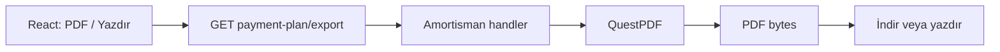
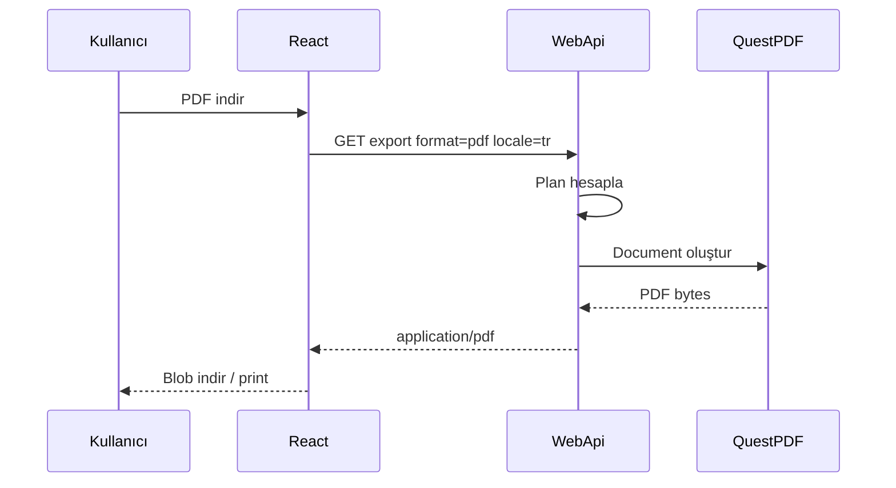

# 20 — QuestPDF ve ödeme planı export

[← Önceki](19-vault-lab.md) · [İçindekiler](00-index.md) · [Sonraki →](21-ci-github-actions.md)

## Bu nedir?

**QuestPDF**, C# koduyla PDF üreten bir kütüphanedir (HTML’e bağımlı olmadan sayfa düzeni kurarsın).  
BankApp’te kredi **amortisman / ödeme planını** PDF indirmek ve yazdırmak için kullanılır.

**Benzetme:** Excel’de tabloyu “PDF olarak kaydet” demek gibi — ama düzen ve etiketler sunucuda, locale’e göre üretilir.



## Bu projede ne işe yarar?

- API: `payment-plan/export?format=pdf&locale=…`
- Pluggable exporter (`IPaymentPlanDocumentExporter`) — ileride CSV/XLSX eklenebilir
- Locale’e göre etiket + para sembolleri (₺ $ €)

Ekran: [Bank Manager — Print & PDF](../../screenshots/bank-manager.en.md)

## Ne zaman eklendi?

PDF/print UX: Faz 6 sonrası özellik dilimi (README Features + screenshots).

## Temel kavramlar

| Kavram | Anlamı |
|--------|--------|
| **Exporter** | Belge → `byte[]` / dosya |
| **Locale** | PDF yazı dili (`tr` / `en` / `de`) |
| **Amortization** | Taksit, faiz, kalan anapara tablosu |



## Komutlar

```powershell
dotnet add src/Application package QuestPDF
```

HTTP (Bearer token ile):

```http
GET /api/CreditApplications/{id}/payment-plan/export?format=pdf&locale=tr
```

(Gerçek route’u repodaki `applicationsApi` / controller ile doğrula; query’de `locale` ve gerekirse plan parametreleri vardır.)

## Sınıflar, metotlar, paketler

| İsim | Rol |
|------|-----|
| `QuestPDF` | PDF motoru |
| `PaymentPlanPdfExporter` | `IPaymentPlanDocumentExporter` |
| `PaymentPlanPdfLabels.For(locale)` | TR/EN/DE etiket |
| `PaymentPlanMoneyFormatter` | Sembollü tutar |
| `exportPaymentPlan` (client) | Blob indir + print |

## Repoda nerede?

```
src/Application/Services/Amortization/Export/
client/src/api/applicationsApi.ts
client/src/pages/ApplicationDetailPage.tsx
docs/screenshots/bank-manager.en.md
```

## Mini akış

UI “PDF” → `locale` + plan → handler hesaplar → QuestPDF document → dosya indir / print dialog.

## Yeni başlayan lab

1. Onaylı bir başvurunun detayına gir (ödeme planı görünen).
2. PDF indir — dosyanın açıldığını kontrol et.
3. Dil EN/DE yapıp tekrar indir — başlık dilinin değiştiğini gör.
4. Yazdır’ı dene (tarayıcı print dialog).

## Sık yapılan hatalar

- Locale göndermemek → varsayılan dil / yanlış etiket  
- PDF’i JSON sanıp `response.json()` çağırmak → bozulur; blob kullanılmalı  
- Mermaid/dokümanda `byte[]` gibi iç içe köşeli parantez yazmak diyagramı kırar  

## Nerede işe yarar?

- [ ] PDF indiriliyor ve açılıyor  
- [ ] TR/EN/DE etiketler locale ile uyumlu  
- [ ] Print yolu çalışıyor  
