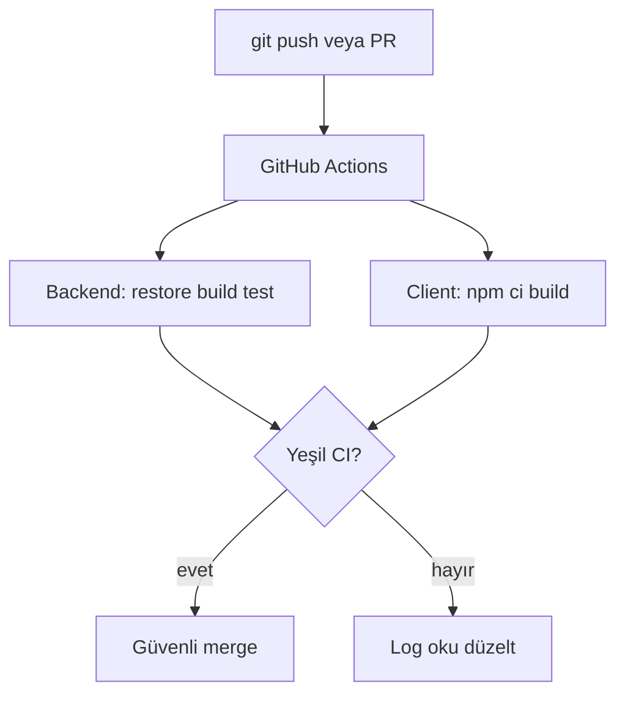
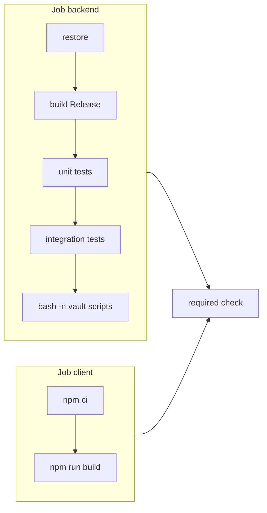

# 21 — GitHub Actions CI

[← Önceki](20-pdf-export.md) · [İçindekiler](00-index.md) · [Sonraki →](22-decision-letter-email.md)

## Bu nedir?

**CI** (Continuous Integration): Her push veya PR’da otomatik build + test.  
**GitHub Actions**: Repo içi YAML workflow’ları GitHub runner’da çalıştırır — yeşil tik olmadan main’e güvenmezsin.

**Benzetme:** Her commit’ten önce çalışan **fabrika kalite bandı** — ürün (kod) banttan geçer, hata varsa kutular kırmızıya düşer; elle her seferinde `dotnet test` hatırlamak gerekmez.



## Bu projede ne işe yarar?

`.github/workflows/ci.yml`:

1. Backend: restore → build → unit → integration  
2. Client: Node setup → `npm ci` / build  

Yeşil CI = main’e güven. NuGet ve npm cache ile runner süresi kısalır.

## Ne zaman eklendi?

**Faz 5** civarı; sonra genişletildi (ubuntu pin, cache v5, nullable temizliği).

## Temel kavramlar

| Kavram | Anlamı |
|--------|--------|
| **Workflow** | YAML dosyası (tetikleyici + job’lar) |
| **Job** | Paralel çalışabilen iş (backend / client) |
| **Step** | Job içi adım (checkout, build, …) |
| **Runner** | `ubuntu-24.04` sanal makine |
| **Badge / check** | PR’da geçti/kaldı işareti |
| **Cache** | Client: `setup-node` `cache: npm`; Backend: `actions/cache` → `~/.nuget/packages` |



## Komutlar

Yerelde CI’yı taklit (aynı sıra önerilir):

```powershell
dotnet restore BankApp.slnx
dotnet build BankApp.slnx --configuration Release --no-restore
dotnet test tests/Application.UnitTests/Application.UnitTests.csproj -c Release --no-build
dotnet test tests/WebApi.IntegrationTests/WebApi.IntegrationTests.csproj -c Release --no-build

# CI: Vault lab script sözdizimi (Vault çalıştırmadan)
bash -n infra/scripts/vault-seed.sh
bash -n infra/scripts/vault-rotate-jwt.sh

cd client
npm ci
npm run build
```

GitHub CLI (remote sonuçlar):

```powershell
gh run list --limit 5
gh run view <id> --log-failed
```

**Ne bakılır?** İlk kırmızı step — genelde restore, compile veya integration DB bağlantısı.

### Felaket / kurtarma (geliştirici)

| Durum | Yol |
|-------|-----|
| Sadece client kırmızı | `client` → `npm ci` + `npm run build` lokal |
| NU1605 / paket çakışması | `dotnet list package --vulnerable` + csproj düzelt |
| Integration fail | Testcontainers / SQL — integration projesini tek başına çalıştır |
| Cache bozuk hissi | Actions’ta cache miss normal; `--no-restore` zincirini lokal doğrula |

## Sınıflar, metotlar, paketler

Actions (Node 24 runtime — v4 Node 20 deprecation uyarısını temizler):

- `actions/checkout@v5`
- `actions/setup-dotnet@v5`
- `actions/setup-node@v5` (`cache: npm`)
- `actions/cache@v5` (NuGet `~/.nuget/packages`, key = csproj/slnx hash; Node 24)
- Runner: `ubuntu-24.04`

## Repoda nerede?

```
.github/workflows/ci.yml
```

## Mini akış

`git push` → Actions tetiklenir → NU1605 / test fail varsa kırmızı → `gh run view … --log-failed` → düzelt → tekrar push → yeşil.

Ekran (CI aynı stack'i doğrular — API dokümantasyonu):


## Yeni başlayan lab

1. Küçük bir branch aç → README’ye boşluk ekle → push → Actions sekmesini aç.
2. Yeşil bitene kadar bekleyin; süre ve iki job’u not al.
3. Bilerek `client`’ta geçici syntax hatası yap → push → client job kırmızı mı gör.
4. Hatayı geri al → yeşil.
5. Lokalde yukarıdaki `dotnet test` + `npm ci` zincirini bir kez elle çalıştır — CI ile aynı mı.

## Sık yapılan hatalar

- Sadece `npm run dev` ile geçip `npm run build`’i hiç denememek — prod build client job’da patlar  
- `package-lock.json` güncellemeden `package.json` değiştirmek — `npm ci` fail  
- Integration testleri lokal atlayıp PR açmak — SQL/Testcontainers runner’da farklı hata verebilir  
- Actions sürümünü düşürüp Node 20 deprecation uyarısını geri getirmek  

## Nerede işe yarar?

- [ ] Push/PR’da CI otomatik koşuyor  
- [ ] Backend + client job’ları yeşil  
- [ ] Lokal `Release` build + test CI ile uyumlu  
- [ ] Kırmızı run’da `gh run view --log-failed` anlamlı hata gösteriyor
