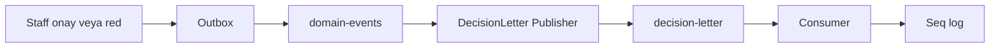
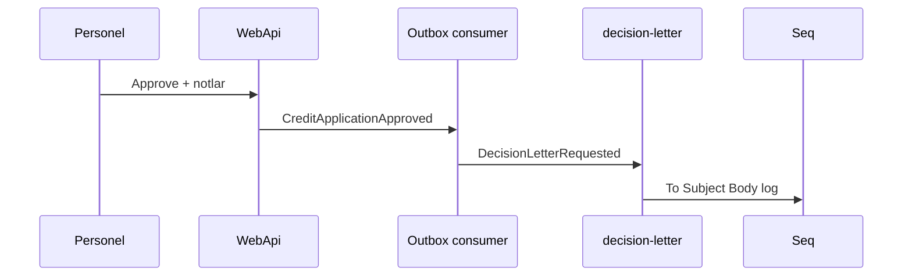

# 22 — Karar mektubu e-posta (lab)

[← Önceki](21-ci-github-actions.md) · [İçindekiler](00-index.md) · [Sonraki →](25-decision-letter-sms.md)

İlgili: [13 RabbitMQ](13-rabbitmq.md) · [14 Outbox](14-outbox-events.md) · [25 SMS lab](25-decision-letter-sms.md)

## Bu nedir?

Personel kredi başvurusunu **onayladığında veya reddettiğinde** müşteriye giden “karar mektubu” bildirimi.  
BankApp lab’inde gerçek SMTP yok: mesaj **RabbitMQ** kuyruğuna yazılır, consumer **Seq/Serilog**’a loglar (e-posta doğrulama ile aynı eğitim modeli).

**Benzetme:** Mektup **faks simülasyonu** — içerik gerçek, postacı yok; kağıt yerine Seq’te satır görürsün.



## Bu projede ne işe yarar?

- UI’daki onay/red **notes** şablonları müşteriye iletilir (body).
- Outbox → `domain-events` akışına bağlıdır; SignalR toast’tan sonra tetiklenir.
- Kuyruk adı: `decision-letter` (`RabbitMqOptions.DecisionLetterQueue`).

## Ne zaman eklendi?

Roadmap “İleride” maddesi — e-posta lab dilimi; SMS ayrı bölümde ([25](25-decision-letter-sms.md)).

## Temel kavramlar

| Kavram | Anlamı |
|--------|--------|
| **Decision letter** | Onay/red sonrası müşteriye metin |
| **Publisher** | `IDecisionLetterPublisher` → kuyruğa basan servis |
| **Consumer** | `DecisionLetterConsumerHostedService` |
| **Lab delivery** | Log = e-posta yerine geçer (eğitim) |
| **Broker kapalı** | Publisher uyarı loglar; onay akışı kırılmaz |



## Komutlar

```powershell
cd infra
docker compose --env-file .env up -d rabbitmq webapi seq
```

RabbitMQ UI → Queues → `decision-letter`.  
Seq → http://localhost:5341 → “Decision letter” veya `ToEmail` ara.

```powershell
# Consumer log
docker compose --env-file .env logs --tail=50 webapi | Select-String -Pattern "Decision"
```

Broker kapalıysa publisher uyarı loglayıp body’yi yine yazar (kayıt/onay akışı kırılmaz) — bilinçli lab davranışı.

### Ne kontrol edilir?

| Kontrol | Nasıl | İyi görünüm |
|---------|-------|-------------|
| Kuyruk | Rabbit UI | Consumers ≥ 1 |
| Mesaj akışı | Onay sonrası | Ready artıp azalır |
| İçerik | Seq | To, Subject, Body görünür |
| Unit | `DecisionLetterRequestedTests` | yeşil |

```powershell
dotnet test tests/Application.UnitTests/Application.UnitTests.csproj --filter "DecisionLetter"
```

## Sınıflar, metotlar, paketler

| İsim | Rol |
|------|-----|
| `DecisionLetterRequested` | Mesaj kaydı (ToEmail, Subject, Body, Decision, …) |
| `IDecisionLetterPublisher` | Soyutlama |
| `RabbitMqDecisionLetterPublisher` | Kuyruğa publish / disabled fallback log |
| `DecisionLetterConsumerHostedService` | Consume + Seq log |
| `DomainEventsConsumerHostedService.TryPublishDecisionLetterAsync` | Approve/Reject sonrası yayın |
| `RabbitMqOptions.DecisionLetterQueue` | Varsayılan `decision-letter` |

Paket: `RabbitMQ.Client` (mevcut Notification host).

## Repoda nerede?

```
src/Application/Services/Messaging/DecisionLetterRequested.cs
src/Application/Services/Messaging/IDecisionLetterPublisher.cs
src/WebApi/Modules/Notification/Messaging/RabbitMqDecisionLetterPublisher.cs
src/WebApi/Modules/Notification/Messaging/DecisionLetterConsumerHostedService.cs
src/WebApi/Modules/Notification/Messaging/DomainEventsConsumerHostedService.cs
src/WebApi/Modules/Notification/NotificationHostModule.cs
tests/Application.UnitTests/Services/Messaging/DecisionLetterRequestedTests.cs
```

## Mini akış

Staff onaylar → Outbox → `domain-events` → Saga + SignalR → müşteri e-postası bulunur → `DecisionLetterRequested` → `decision-letter` kuyruğu → consumer Seq’e `To` / `Subject` / `Body` yazar.

UI’da mektup kalıbı (onay/red notu — kuyruğa gidecek body):


Lab’de “gönderilen e-posta” Seq’te görünür:


## Yeni başlayan lab

1. İki servis ayakta: rabbitmq, webapi, seq.
2. Personel hesabıyla başvuruyu onayla — not alanına ayırt edici bir cümle yaz.
3. RabbitMQ → `decision-letter` Ready hareketini izle.
4. Seq’te aynı cümlenin `Body` içinde olduğunu bul.
5. `docker compose stop rabbitmq` → tekrar onay dene → WebApi uyarı logu + işlem 200 mü bak (lab fallback).

## Sık yapılan hatalar

- Seq’te aramadan “e-posta gitmedi” demek — lab’de giden yer Seq  
- Outbox/SignalR çalışıp decision-letter consumer’ı unutmak  
- Müşteri e-postası boş seed hesabında — `ToEmail` null/empty log  
- Rabbit UI’dan mesaj silip “neden bir daha yok” diye şaşırmak  

## Nerede işe yarar?

- [ ] Onay/red sonrası `decision-letter` kuyruğu işliyor  
- [ ] Seq’te To/Subject/Body dolu  
- [ ] `DecisionLetter` unit testleri geçiyor  
- [ ] Broker down iken onay HTTP akışı kırılmıyor (uyarı log)
