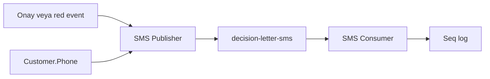
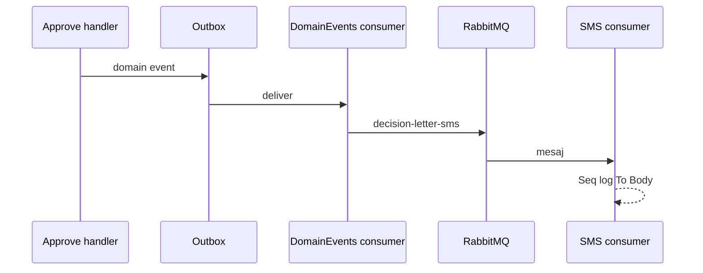

# 25 — Karar mektubu SMS (lab)

[← Önceki](24-lab-tools.md) · [İçindekiler](00-index.md) · [Sonraki →](26-credit-application-documents.md)

İlgili: [22 E-posta lab](22-decision-letter-email.md) · [13 RabbitMQ](13-rabbitmq.md) · [07 Seq](07-serilog-seq.md)

## Bu nedir?

Onay/red sonrası müşteriye giden **SMS** bildirimi.  
Gerçek SMS gateway (Twilio vb.) yok: mesaj **RabbitMQ** → consumer **Seq**’e loglar (e-posta lab ile aynı eğitim modeli).

**Benzetme:** Gerçek kurye yerine “SMS’i deftere yaz” — e-posta lab’inde mektup kuryesi yerine Seq’e yazılıyordu; SMS de aynı deftere kısa satır olarak düşer.



## Bu projede ne işe yarar?

- E-posta decision-letter ile **aynı anda** tetiklenir (approve/reject domain event).
- Telefon `Customer.PhoneNumber` alanından alınır; yoksa skip + warning (akış kırılmaz).
- Kuyruk: `decision-letter-sms`.
- Body kısa tutulur (lab’de max ~320 karakter; notes varsa ondan).

## Ne zaman eklendi?

Roadmap “Karar mektubunu SMS ile gönderme” — e-posta lab’inden sonra kolay dilim.

## Temel kavramlar

| Kavram | Anlamı |
|--------|--------|
| **Decision SMS** | Onay/red kısa metin (telefon) |
| **Lab delivery** | Seq log = SMS yerine geçer |
| **Skip** | Telefon yoksa yayınlama |



## Komutlar

```powershell
cd infra
docker compose --env-file .env up -d rabbitmq webapi
# Kontrol: RabbitMQ UI → Queues → decision-letter-sms (Consumers ≥ 1)
```

```powershell
# Onay/red yaptıktan sonra
# Seq: "Decision SMS consumed"  (To= telefon, Body=…)
docker compose --env-file .env logs --tail=50 webapi
```

Broker kapalıysa publisher uyarı loglayıp body’yi yine yazar (kayıt/onay kırılmaz).

### Ne kontrol edilir?

| Kontrol | İyi görünüm |
|---------|-------------|
| Queue `decision-letter-sms` | Consumers ≥ 1 |
| Approve/reject | Seq’te e-posta + SMS satırları |
| Telefonu boş müşteri | Warning skip; e-posta hâlâ gidebilir |

## Sınıflar, metotlar, paketler

| İsim | Rol |
|------|-----|
| `DecisionSmsRequested` | ToPhone, Body, Decision, … |
| `IDecisionSmsPublisher` / `RabbitMqDecisionSmsPublisher` | Kuyruğa publish |
| `DecisionSmsConsumerHostedService` | Consume → Seq |
| `TryPublishDecisionSmsAsync` | Domain events consumer içinde |
| `RabbitMqOptions.DecisionSmsQueue` | Varsayılan `decision-letter-sms` |

## Repoda nerede?

```
src/Application/Services/Messaging/DecisionSmsRequested.cs
src/Application/Services/Messaging/IDecisionSmsPublisher.cs
src/WebApi/Modules/Notification/Messaging/RabbitMqDecisionSmsPublisher.cs
src/WebApi/Modules/Notification/Messaging/DecisionSmsConsumerHostedService.cs
src/WebApi/Modules/Notification/Messaging/DomainEventsConsumerHostedService.cs
src/WebApi/Modules/Notification/NotificationHostModule.cs
tests/.../DecisionSmsRequestedTests.cs
```

## Mini akış

Staff onaylar → Outbox → `domain-events` → SignalR + decision-letter e-posta + **decision-letter-sms** → consumer Seq’e `To` / `Body` yazar.

Ekran (Seq log):


## Yeni başlayan lab

1. RabbitMQ UI açık; `decision-letter-sms` kuyruğu listede.
2. Telefonu dolu müşteri ile Pending başvuruyu staff olarak **onayla**.
3. Seq’te `Decision SMS` veya benzeri satır — `To=` telefon, `Body=` kısa metin.
4. Aynı akışta e-posta kuyruğu logunu da gör ([22](22-decision-letter-email.md)).
5. Telefonu boş müşteri ile red et → warning skip; kuyruk şişmez.

## Sık yapılan hatalar

- Sadece **e-posta** kuyruğuna bakmak — SMS ayrı kuyruk `decision-letter-sms`.
- Seq’te arama yaparken **e-posta subject** aramak — SMS body kısa, farklı log mesajı.
- RabbitMQ kapalı sanıp onayın kırıldığını düşünmek — publish uyarısı; karar DB’de kalır.
- Mermaid’de `Onay/red` slash — tırnaklı etiket kullan.

## Nerede işe yarar?

### Sağlık checklist

| Kontrol | İyi görünüm |
|---------|-------------|
| Consumers ≥ 1 | SMS consumer ayakta |
| Approve + telefon | Seq SMS satırı |
| Skip | Warning, akış 200 |

### Felaket / kurtarma (lab)

| Durum | Yol |
|-------|-----|
| Kuyruk birikiyor | `logs webapi`; consumer restart |
| Hiç mesaj yok | Domain event mi; telefon skip mi |
