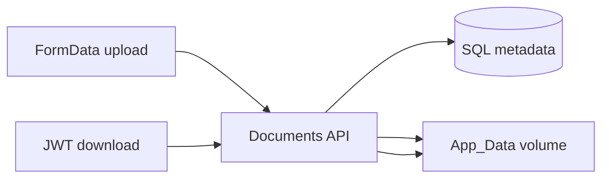
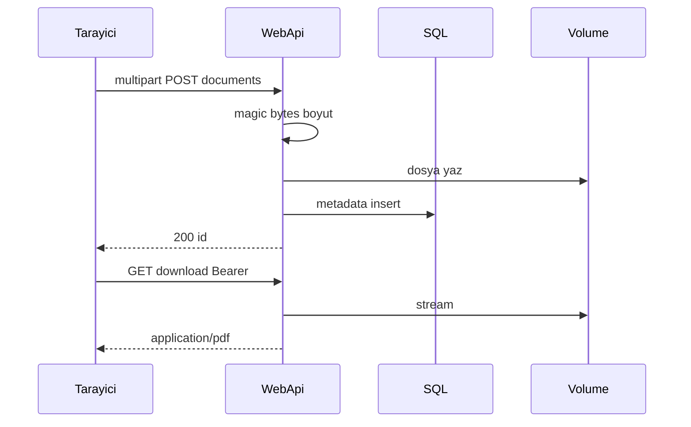

# 26 — Kredi başvurusu evrak yükleme (lab)

[← Önceki](25-decision-letter-sms.md) · [İçindekiler](00-index.md) · [Sonraki →](27-branch-model.md)

İlgili: [03 EF Core](03-ef-core-sql.md) · [06 JWT / RBAC](06-jwt-rbac.md) · profil avatar (aynı multipart deseni)

## Bu nedir?

Başvuruya **kimlik / gelir belgesi / diğer** dosya eklemek.  
Dosya diskte (`App_Data`, wwwroot değil); metadata SQL’de. İndirme **JWT’li API** ile — StaticFiles ile herkese açık değil.

**Benzetme:** Banka kasasındaki evrak: kartotekte indeks (SQL), asıl dosya kapalı rafta (volume); fotokopi yalnızca kimlik gösteren müşteri/personel alır (JWT download).



## Bu projede ne işe yarar?

- Pending başvuruya müşteri veya personel evrak yükler (lab; onay için henüz zorunlu değil).
- Türler: `IdentityDocument`, `IncomeProof`, `Other` (SmartEnum).
- Limit: ≤ 5 MB; PDF / JPEG / PNG; başvuru başına en fazla 10 dosya.
- Pending iken **önizleme / indirme / kaldırma** (soft-delete + disk silme); kaldırmada tarayıcı onayı (i18n).
- Compose volume: `credit-document-uploads` → `/app/App_Data/credit-documents`.

## Ne zaman eklendi?

Roadmap “evrak yükleme” dilimi (2026-10-28); avatar upload deseninden türetildi.

## Temel kavramlar

| Kavram | Anlamı |
|--------|--------|
| **Multipart / IFormFile** | Tarayıcı `FormData` → API dosya alanı |
| **Metadata vs blob** | SQL satırı + disk yolu |
| **App_Data** | wwwroot dışı; static serve yok |
| **Magic bytes** | Content-Type’ın gerçek içeriğe uyumu |
| **Path traversal koruması** | Storage path kök dışına çıkamaz |



## Komutlar

Migration (zaten repoda; yeni ortamda WebApi migrate eder):

```powershell
dotnet ef migrations add AddCreditApplicationDocuments `
  --project src/Persistence/Persistence.csproj `
  --startup-project src/WebApi/WebApi.csproj
# Sonra: WebApi ayağa kalkınca MigrateAsync tabloyu oluşturur
```

Compose volume + WebApi recreate (dosyalar volume’da kalır):

```powershell
cd infra
docker compose --env-file .env up -d --build webapi client
docker compose --env-file .env ps
# Beklenen: webapi healthy; volume bankapp-credit-document-uploads
```

Scalar / curl ile yükleme (Pending başvuru + JWT):

```powershell
curl -X POST "http://localhost:8080/api/CreditApplications/<APP_ID>/documents" `
  -H "Authorization: Bearer <TOKEN>" `
  -F "documentType=IdentityDocument" `
  -F "file=@C:\temp\kimlik.pdf;type=application/pdf"
# Beklenen: 200 + id / originalFileName
```

Liste + indirme:

```powershell
curl -s -H "Authorization: Bearer <TOKEN>" `
  "http://localhost:8080/api/CreditApplications/<APP_ID>/documents"

curl -L -H "Authorization: Bearer <TOKEN>" `
  -o indirilen.pdf `
  "http://localhost:8080/api/CreditApplications/<APP_ID>/documents/<DOC_ID>/download"
```

## Sınıflar, metotlar, paketler

| İsim | Rol |
|------|-----|
| `CreditApplicationDocument` | Entity |
| `CreditDocumentType` | SmartEnum |
| `ICreditDocumentStorage` / `LocalCreditDocumentStorage` | Disk I/O |
| `UploadCreditApplicationDocumentRequest` | MediatR upload |
| `DeleteCreditApplicationDocumentRequest` | MediatR silme (Pending) |
| `CreditApplicationDocumentBusinessRules` | Boyut / tip / Pending / limit |

## Repoda nerede?

```
src/Domain/Entities/CreditApplicationDocument.cs
src/Domain/Enums/CreditDocumentType.cs
src/Application/Modules/Credit/Features/CreditApplicationDocuments/
src/WebApi/Services/LocalCreditDocumentStorage.cs
src/WebApi/Modules/Credit/Controllers/CreditApplicationsController.cs  # …/documents*
infra/docker-compose.yml  # credit-document-uploads
client/src/pages/ApplicationDetailPage.tsx
```

## Mini akış

1. Müşteri **yeni başvuru** formunda (isteğe bağlı) dosya seçer → kayıt → `POST` create → ardından `POST …/documents` → detay sayfasına yönlenir.  
2. Veya mevcut **Pending** başvuru detayında Evraklar paneli → yükle / liste / önizle / indir / kaldır.

## Yeni başlayan lab

1. Müşteri token ile Pending başvuru aç veya oluştur.
2. Detayda küçük bir PDF yükle → listede görünür.
3. Önizle (modal) ve İndir → dosya açılır.
4. Kaldır → onay penceresi → listeden düşer; zorunlu tür silinirse “Evrak eksik” geri gelebilir.
5. Token’sız download URL dene → 401.
6. `docker volume ls` → `bankapp-credit-document-uploads` var.

## Sık yapılan hatalar

- Dosyayı **wwwroot** altında aramak — yol `App_Data`, static serve yok.
- **Approved** başvuruya upload — UI gizli; API iş kuralı.
- `Content-Type` spoof — sunucu magic bytes kontrol eder.
- Volume silmeden “dosya nerede” diye SQL’e bakmak — blob diskte.
- Mermaid’de `[(SQL)]` yerine tırnaklı düğüm kullanmak daha güvenli.

## Nerede işe yarar?

### Sağlık checklist

| Kontrol | Nasıl | İyi görünüm |
|---------|-------|-------------|
| Tablo | SQL `CreditApplicationDocuments` | Migration sonrası var |
| Volume | `docker volume ls` | `bankapp-credit-document-uploads` |
| Upload UI | Pending detay | Form görünür; Approved’da yok |
| Auth | Token’suz download | 401 |
| Tip | `.gif` / 6 MB | 400 business message |

### Felaket / kurtarma (lab)

| Durum | Yol |
|-------|-----|
| Metadata var, dosya yok | Volume silindi / yanlış mount; yeniden yükle |
| Volume wipe | `docker volume rm bankapp-credit-document-uploads` (**yıkıcı**) → recreate webapi |
| Disk dolu | Eski lab dosyalarını sil veya volume recreate |
| Migration yok | WebApi log + `MigrateAsync`; gerekirse `dotnet ef database update` |
