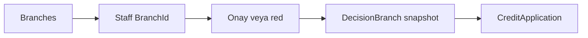
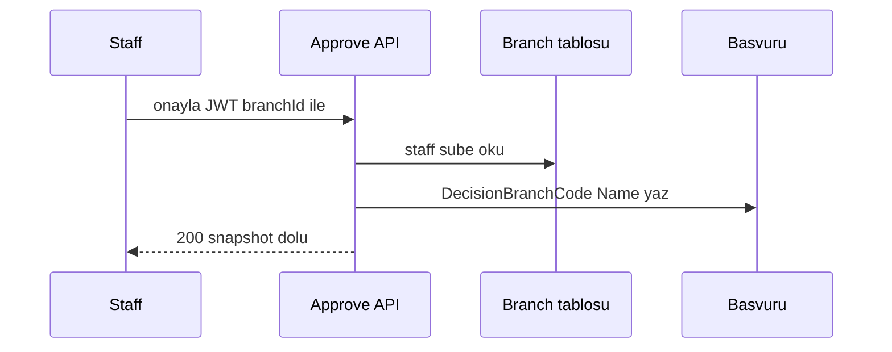

# 27 — Şube / branch modeli

[← Önceki](26-credit-application-documents.md) · [İçindekiler](00-index.md)

İlgili: [06 JWT / RBAC](06-jwt-rbac.md) · personel yönetimi

## Bu nedir?

**Şube (Branch)**: Bankanın fiziksel / organizasyonel birimi. Personel bir şubeye bağlanır; onay/red anında şube bilgisi başvuruya **snapshot** olarak yazılır (sonradan personelin şubesi değişse bile karar kaydı bozulmaz).

**Benzetme:** Fotoğraf makinesi: karar anında şubenin adını başvuruya “çekilmiş foto” gibi yapıştırırsın; personel sonra başka şubeye transfer olsa fotoğraf değişmez.



## Bu projede ne işe yarar?

- Tablo `Branches` (Code, Name, City, IsActive, MaxApprovalAmount — isteğe bağlı DoA şube tavanı; ayrıntı [30](30-approve-gate-authority.md)).
- `ApplicationUser.BranchId` — demo staff seed ile atanır.
- Onay/red → `DecisionBranchCode` / `DecisionBranchName` başvuru üzerinde.
- API: `GET /api/Branches`; personel listesi / profil / başvuru detayında görünür.
- Yönetici personel düzenlerken şube atayabilir.

## Ne zaman eklendi?

Roadmap “şube modeli” lab dilimi (2026-10-29).

## Temel kavramlar

| Kavram | Anlamı |
|--------|--------|
| **Snapshot** | Karar anındaki kod/ad kopyası (canlı FK değil) |
| **BranchId** | Personelin güncel şube FK’si |
| **Seed sync** | Wipe olmadan demo şube + staff BranchId doldurma |



## Komutlar

```powershell
# Migration zaten repoda; WebApi ayağa kalkınca MigrateAsync uygular
cd infra
docker compose --env-file .env up -d --build webapi client
# Seed: IST-01, ANK-01, BER-01; staff@ → IST-01, manager@ → ANK-01, …
```

```powershell
# Şube listesi (JWT staff)
curl -s -H "Authorization: Bearer <TOKEN>" http://localhost:8080/api/Branches
```

## Sınıflar, metotlar, paketler

| İsim | Rol |
|------|-----|
| `Branch` | Entity |
| `BranchSeed` | Demo şubeler |
| `GetListBranchRequest` | Liste query |
| `Approve` / `Reject` handler | Decision branch snapshot |
| `BranchesController` | `GET /api/Branches` |

## Repoda nerede?

```
src/Domain/Entities/Branch.cs
src/Persistence/Seed/BranchSeed.cs
src/Application/Modules/Identity/Features/Branches/
src/WebApi/Modules/Identity/Controllers/BranchesController.cs
client/src/pages/StaffPage.tsx
client/src/pages/ApplicationDetailPage.tsx
```

## Mini akış

Seed şube → staff BranchId → personel onaylar → başvuruda DecisionBranch* dolar → detay UI’da “Karar şubesi”.

Ekran (Manager — şubeye göre kredi filtresi):


## Yeni başlayan lab

1. `staff.tr@bank.local` ile login → profil veya personel listesinde şube kodu (ör. IST-01).
2. `GET /api/Branches` → üç demo şube.
3. Pending başvuruyu onayla → detayda **Karar şubesi** dolu.
4. SQL’de `DecisionBranchCode` — personel `BranchId` değişince eski onaylı kayıt aynı kalmalı.

## Sık yapılan hatalar

- **BranchId** ile **DecisionBranch*** alanlarını karıştırmak — biri canlı FK, diğeri snapshot.
- Staff şubesiz seed → onayda boş karar şubesi; `EnsureDemoStaffBranches`.
- Şube listesini token’sız çağırmak → 401.
- Mermaid’de `Onay/red` slash — tırnaklı etiket.

## Nerede işe yarar?

### Sağlık checklist

| Kontrol | Nasıl | İyi görünüm |
|---------|-------|-------------|
| Tablo | SQL `Branches` | 3 demo satır |
| Staff | Personel listesi | Şube kolonu dolu |
| Snapshot | Pending’i onayla | Detayda IST-01 · … |
| API | GET /api/Branches | JSON dizi |

### Felaket / kurtarma

| Durum | Yol |
|-------|-----|
| BranchId boş | Seed tekrar (WebApi restart); EnsureDemoStaffBranches |
| Migration yok | WebApi log / `dotnet ef database update` |
| Yanlış şube | Manager personel edit → şube seç |
