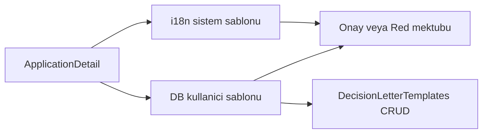
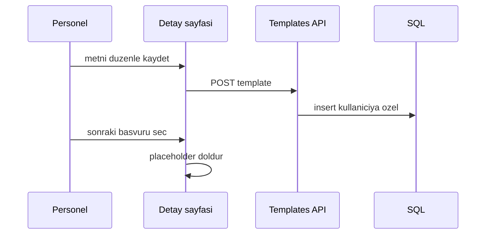

# 29 — Karar mektubu şablonları (kullanıcı CRUD)

[← Önceki](28-branch-rbac-superadmin.md) · [İçindekiler](00-index.md) · [Sonraki →](30-approve-gate-authority.md)

## Bu nedir?

Onay / red sonrası müşteriye giden mektubun **kişisel şablonları**. Sistem varsayılanları istemci i18n’de kalır; personel kendi metinlerini kaydedip seçebilir.

**Benzetme:** Word’de “kurumsal şablon” + “benim kaydettiğim paragraf” — sistem metni bankanın standart mektubu; kullanıcı şablonu senin favori cümlen.



## Bu projede ne işe yarar?

Başvuru detayında personel:

1. Arayüz diline göre sistem şablonunu otomatik doldurur
2. TR / EN / DE sistem şablonlarından birini seçebilir
3. Düzenlenmiş metni “şablon olarak kaydet” ile kendi hesabına yazar
4. Sonraki kararlarda kayıtlı şablonu tekrar kullanır

## Ne zaman eklendi?

Şube RBAC / SuperAdmin dalından hemen sonra (Faz 6 UX).

## Temel kavramlar

| Kavram | Anlam |
|--------|--------|
| Kind | `Approve` veya `Reject` |
| Locale | Şablon dili (`tr` / `en` / `de`) — UI dilinden bağımsız seçilebilir |
| System template | `client` i18n (`applications.templates.*`) |
| User template | DB tablosu `DecisionLetterTemplates`, kullanıcıya özel |
| Placeholders | `customerName`, `applicationNumber`, `amount`, `term`, `rate`, `reason` |



## Komutlar

Migration uygulandıktan sonra API ayaktayken şablon listesi (JWT gerekli):

```powershell
# Login (lab şifresi hepsi aynı)
curl.exe -s -X POST http://localhost:8080/api/Auth/Login `
  -H "Content-Type: application/json" `
  -d "{\"email\":\"staff.tr@bank.local\",\"password\":\"Demo123!\"}"
```

Doğrulama: yanıtta `accessToken` gelir. Sonra:

```powershell
curl.exe -s http://localhost:8080/api/DecisionLetterTemplates `
  -H "Authorization: Bearer <token>"
```

Beklenen: JSON dizi (ilk kullanımda boş olabilir).

## Sınıflar, metotlar, paketler

- Entity: `DecisionLetterTemplate`
- Repo: `IDecisionLetterTemplateRepository` / `DecisionLetterTemplateRepository`
- MediatR: `Create` / `Update` / `Delete` / `GetList` DecisionLetterTemplate*
- Controller: `DecisionLetterTemplatesController`
- Client: `decisionTemplatesApi.ts`, `ApplicationDetailPage` şablon seçici

## Repoda nerede?

- `src/Domain/Entities/DecisionLetterTemplate.cs`
- `src/Application/Modules/Identity/Features/DecisionLetterTemplates/`
- `src/WebApi/Modules/Identity/Controllers/DecisionLetterTemplatesController.cs`
- `client/src/api/decisionTemplatesApi.ts`
- `client/src/pages/ApplicationDetailPage.tsx`

## Mini akış

Personel Pending başvuruyu açar → sistem şablonu UI dilinde dolar → metni düzenler → “Şablon olarak kaydet” → sonraki başvuruda select’ten kendi şablonunu seçer → Onayla/Reddet.

Ekran (onay/red mektubu şablonları — otomatik doldurulmuş kalıp):


## Nerede işe yarar?

- [ ] Detayda dil değiştirince (metin kirli değilse) mektup yenilenir
- [ ] Kayıtlı şablon silinince select `system`’e döner
- [ ] Başka kullanıcının şablonları listede görünmez

Lab: migration yoksa API 500 verebilir — `AddDecisionLetterTemplates` / `AddDecisionTemplateNameAndDocAudit` migration’larının uygulandığından emin olun (`docker compose up -d --build webapi` veya `dotnet ef database update`).

## İlgili UX (aynı dilim)

- Evrak onay kapısı: `CreditDocuments:ApproveGateMode` (`None` / `Soft` / `Hard`) — ayrıntı [30](30-approve-gate-authority.md)
- Onay yetkisi (DoA): `ApprovalAuthority` — ayrıntı [30](30-approve-gate-authority.md)
- Client: `GET /api/CreditDocuments/config` → `approveGateMode`, `maxApprovalAmount`
- Liste preset (personel): “Bekleyen + eksik evrak” → `Pending` + `missingRequiredDocumentsOnly`
- Karar audit: `DecisionBy` · `DecisionBranch*` · `DecisionTemplateName`
- Evrak yükleme → `CreditApplicationDocumentUploaded` SignalR toast + liste/detay kırmızı rozet

## Yeni başlayan lab

1. `staff.tr@bank.local` / `Demo123!` login.
2. Pending başvuru detay → mektup kutusu UI dilinde dolu.
3. Metni değiştir → “şablon olarak kaydet” → select’te görünür.
4. `GET /api/DecisionLetterTemplates` → kendi kayıtların.
5. Onayla → Seq’te e-posta body şablonla uyumlu ([22](22-decision-letter-email.md)).

## Sık yapılan hatalar

- Şablon **locale** ile UI dilini karıştırmak — şablon dili ayrı seçilebilir.
- Başka personelin şablonunu API’den beklemek — liste kullanıcıya özel.
- Placeholder elle yazarken `{customerName}` formatını bozmak.
- Migration eksik → 500; `docker compose up -d --build webapi`.
- Mermaid’de `Onay/Red` slash — tırnaklı düğüm.
