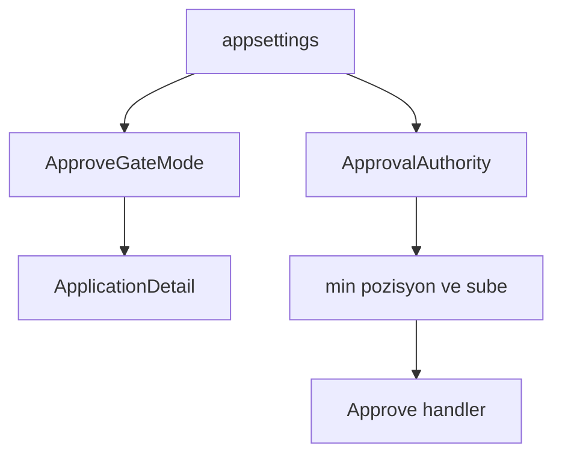
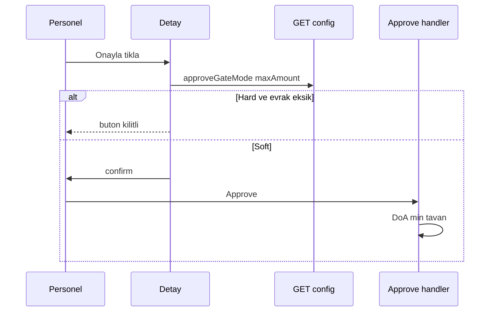

# 30 — Onay evrak kapısı + yetki tavanı (DoA)

[← Önceki](29-decision-letter-templates.md) · [İçindekiler](00-index.md) · [Sonraki →](31-elk-elasticsearch.md)

## Bu nedir?

İki bağımsız config:

1. **ApproveGateMode** — eksik kimlik/gelir için `None` / `Soft` / `Hard`
2. **ApprovalAuthority** — personel pozisyonuna göre max onay tutarı
3. **Branch.MaxApprovalAmount + MaxApprovalCurrencyCode** — isteğe bağlı şube tavanı (PB etiketli); efektif = `min(pozisyon, şube)` yalnız **aynı para biriminde**

**Benzetme:** İki kapı: evrak kapısı (kimlik fotokopisi yok mu?); tutar kapısı (müdürün imza limiti). Soft = uyarı ile içeri alırsın; Hard = turnike kilitli.



## Bu projede ne işe yarar?

Lab’de Development Soft + DoA kapalı; prod-benzeri base Hard + DoA açık. Kod her zaman her iki yolu da içerir; ortam `appsettings` ile seçer. Şube tavanı SuperAdmin şube ekranından yönetilir; UnlimitedRoles her iki tavanı da bypass eder.

## Ne zaman eklendi?

Soft boolean kapıdan hemen sonra (Faz 6 UX / güvenlik).

## Temel kavramlar

| Kavram | Anlam |
|--------|--------|
| Soft | Uyarı + confirm; API onaylar |
| Hard | API + UI blok |
| DoA | Delegation of authority — pozisyon + şube limiti |
| AppliedMax | `min(PositionMax, BranchMax)` (set + PB eşleşenler); eşleşme yoksa `0` |
| CurrencyCode | `ApprovalAuthority:CurrencyCode` (pozisyon); şube kendi `MaxApprovalCurrencyCode` |
| UnlimitedRoles | BankManager / SuperAdmin — pozisyon ve şube tavanını bypass |



## Komutlar

Config’i görmek (JWT personel):

```powershell
# Login sonrası token ile
curl.exe -s http://localhost:8080/api/CreditDocuments/config `
  -H "Authorization: Bearer <token>"
```

Doğrulama: `approveGateMode`, `approvalAuthorityEnabled`, `authorityCurrencyCode`, `maxApprovalAmount`, `positionMaxApprovalAmount` / `positionCurrencyCode`, `branchMaxApprovalAmount` / `branchCurrencyCode`. İsteğe bağlı `?currencyCode=EUR` başvuru PB’sine göre filtreler.

Development’ta Soft’u Hard yapmak için `appsettings.Development.json` içinde `ApproveGateMode` değerini değiştirip API’yi yeniden başlatın.

## Sınıflar, metotlar, paketler

- `ApproveDocumentGateMode`, `CreditDocumentsOptions`
- `ApprovalAuthorityOptions`, `ApprovalAuthorityEvaluator`
- `CreditApplicationBusinessRules.RequiredDocumentsShouldExistWhenHardGate`
- `CreditApplicationBusinessRules.ApprovedAmountShouldBeWithinApprovalAuthority`
- `ApproveCreditApplicationRequestHandler`
- `CreditDocumentsController.GetConfig`
- `Branch.MaxApprovalAmount` / `MaxApprovalCurrencyCode`, şube Create/Update/GetList

## Repoda nerede?

- `src/Application/.../CreditApplicationDocuments/`
- `src/Application/.../ApprovalAuthority/`
- `src/Domain/Entities/Branch.cs`
- `src/WebApi/appsettings.json` / `appsettings.Development.json`
- `client/src/api/creditDocumentsConfigApi.ts`
- `client/src/pages/ApplicationDetailPage.tsx`
- `client/src/pages/BranchesPage.tsx`
- BRD/FRD: `docs/requirements/`

## Mini akış

Personel detayı açar → `GET config` → Soft ise eksik evrakta confirm; Hard ise buton kilitli → DoA açıksa tutar `min(pozisyon, şube)` tavana bakılır (UI kaynak kırılımı gösterir) → Approve handler aynı kuralları sunucuda uygular.

Ekran (Pending detay — onay/red + evrak bağlamı):


Onay/red diyalogu:


## Nerede işe yarar?

- [ ] Development Soft: evraksız onay confirm ile geçer
- [ ] Hard override: evraksız Approve iş kuralı hatası
- [ ] DoA Enabled + CreditAnalyst düşük limit: yüksek tutar reddedilir
- [ ] Şube tavanı pozisyondan düşükse: efektif = şube; UI kırılımı doğru (+ PB sembolü)
- [ ] Şube formu/tabloda para birimi seçilir/görünür
- [ ] Başvuru PB’si şube/pozisyon PB’sinden farklıysa o kaynak “Bu para biriminde yok”; AppliedMax=0
- [ ] Manager rolü: `maxApprovalAmount` null (şube tavanı bypass)

Lab: FX yok; PB etiketli tek-PB limitler.

## Yeni başlayan lab

1. `GET /api/CreditDocuments/config` ile token — `approveGateMode`, `maxApprovalAmount` oku.
2. Development’ta evraksız Pending → Soft ise confirm ile onayla.
3. `appsettings.Development.json` içinde `Hard` yap → webapi recreate → buton kilitli.
4. DoA açıkken düşük limitli analist ile yüksek tutarlı başvuru → red.
5. SuperAdmin şube formunda tavan değiştir → config kırılımı UI’da güncellenir.

## Sık yapılan hatalar

- **ApproveGateMode** ile **ApprovalAuthority**’yi tek ayar sanmak — ayrı config anahtarları.
- Farklı PB’de `min(pozisyon, şube)` beklemek — lab’de PB eşleşmezse AppliedMax 0.
- UI’da confirm geçip API’nin reddetmesini “bug” saymak — handler aynı kuralları uygular.
- `SoftApproveGateEnabled` eski flag adını aramak — güncel: `ApproveGateMode`.
- Mermaid’de `Soft/Hard` slash — virgül veya ayrı düğüm.
