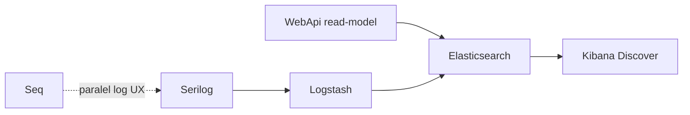
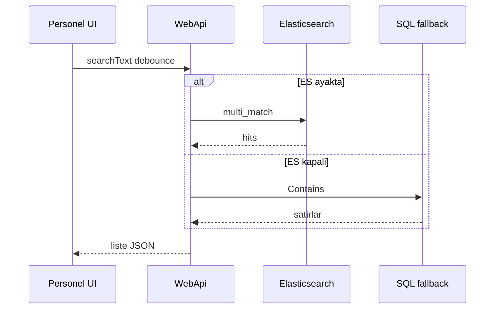

# 31 — ELK (Elasticsearch + Logstash + Kibana)

[← Önceki](30-approve-gate-authority.md) · [İçindekiler](00-index.md) · [Sonraki →](32-admin-tailwind-dashboard.md)

## Bu nedir?

**ELK**, üç parçalı bir gözlem / arama yığınıdır:

| Parça | Rol |
|--------|-----|
| **Elasticsearch** | JSON belgeleri index’ler; full-text + filtre sorguları |
| **Logstash** | Veriyi alır (HTTP/TCP/Beats), dönüştürür, ES’e yazar |
| **Kibana** | Index keşfi, Discover, dashboard UI |

BankApp lab’de ELK **beş iş** için kullanılır:

1. **Kredi başvurusu araması** (ürün read-model → ES; React canlı arama kutusu)  
2. **Personel listesi araması** (`bankapp-staff`; şube / metin / yönetici filtresi; SQL fallback)  
3. **Müşteri listesi** (`bankapp-customers`; şube / metin; facet şube sayaçları)  
4. **Kredi türleri** (`bankapp-credit-types`; metin / locale / kategori / currency / risk + facets)  
5. **Uygulama logları** (Serilog → Logstash HTTP → `bankapp-logs-*`; Kibana’da aranabilir)

**Seq silinmedi.** Seq .NET yapısal log için hızlı lab UX’tir; ELK ise arama motoru + Kibana’dır. İkisi yan yana çalışır.

**Benzetme:** Seq = günlük defter (hızlı bak); Elasticsearch = kütüphane kataloğu (milyon kayıtta arama); Kibana = katalog odası ekranı.



## Bu projede ne işe yarar?

- Başvuru listesinde yazdıkça arama (`searchText`, ~300 ms debounce)
- **Personel sayfası:** `search` + `BranchFilter` + yönetici/aktif chip; SuperAdmin tüm şubeler
- Staff başvuru listesi: şube scoped; Manager/SuperAdmin: daha geniş filtre
- **Manager/SuperAdmin facet paneli (başvurular):** durum / şube / para birimi / eksik evrak / tutar aralığı (`GET …/facets`)
- Liste tutar/para birimi filtresi (`amountMin`/`amountMax`/`currencyCode`)
- ES kapalıysa SQL `Contains` / GroupBy fallback
- Compose: `elasticsearch` :9200, `logstash` :8081/:50000, `kibana` :5601

## Ne zaman eklendi?

Faz 6 — Soft/Hard kapı + DoA sonrasında (roadmap: personel GET araması).

## Temel kavramlar

| Kavram | Anlam |
|--------|--------|
| Index | Tablo benzeri belge koleksiyonu (`bankapp-credit-applications`, `bankapp-staff`, `bankapp-customers`, `bankapp-credit-types`, `bankapp-logs-YYYY.MM.dd`) |
| Document | Tek JSON kayıt (başvuru veya log olayı) |
| Mapping | Alan tipleri (text / keyword / date…) — lab’de index create’te keyword/boolean/number |
| Query | `multi_match`, `term`, `bool` filtre, `range` (tutar) |
| Aggregation | `terms` (status/branch/currency) + `range` (requestedAmount bucket’ları) |
| Facet | Sayaçlı filtre; tıklanınca liste query’sine yazılır |
| Pipeline | Logstash input → filter → output |
| Discover | Kibana’da index pattern ile log/arama gezintisi |

### Seq mi, Elasticsearch mi? (log için)

| | **Seq** | **Elasticsearch + Kibana** |
|--|---------|----------------------------|
| Amaç | .NET yapısal log, hızlı debug | Genel arama, dashboard, çok kaynak |
| Kurulum | Hafif | Daha ağır (RAM) |
| Günlük DX | Serilog sink, güzel UI | Güçlü ama ops maliyeti |
| BankApp lab | **Birincil log UX** | Kibana’da log **da** aranabilir (opsiyonel derinlik) |

**Sonuç:** Seq’i ES ile **değiştirme**; log aramasını Kibana ile **genişlet**. Üretimde bazı ekipler yalnızca ELK tutar — lab’de ikisini bilmek daha öğretici.



## Komutlar

### Yığını ayağa kaldır

```powershell
cd infra
copy .env.example .env   # yoksa
docker compose --env-file .env up -d elasticsearch logstash kibana
```

Sonra: `docker compose --env-file .env ps` → elasticsearch/kibana healthy olmalı.  
RAM yetmezse `.env` içinde `ELASTIC_JAVA_OPTS=-Xms256m -Xmx256m` dene.

### Elasticsearch sağlık

```powershell
curl.exe -s http://localhost:9200
curl.exe -s http://localhost:9200/_cluster/health?pretty
```

Beklenen: `status` green/yellow (tek düğümde yellow normal olabilir).

### Index listesi

```powershell
curl.exe -s http://localhost:9200/_cat/indices?v
```

WebApi ayağa kalkınca `bankapp-credit-applications`, `bankapp-staff`, `bankapp-customers`, `bankapp-credit-types` ve (log geldikçe) `bankapp-logs-*` görünür.

### Logstash’e test (TCP json_lines)

```powershell
# Tek satır JSON (Logstash :50000)
echo '{"message":"lab-tcp-test","level":"Information"}' | curl.exe -s telnet://127.0.0.1:50000
```

Windows’ta TCP için alternatif: WebApi’yi Logstash açıkken çalıştırıp Seq + Kibana Discover’ı kontrol et.

### Kibana

Tarayıcı: http://localhost:5601  

1. Stack Management → Data Views → `bankapp-logs-*` (timestamp alanı)  
2. Discover → logları filtrele  
3. İkinci data view: `bankapp-credit-applications` (ürün araması index’i)  
4. Lens / Dashboard: `status` alanına göre pasta/çubuk (zaman aralığı: Last 1 year)

Ekran örneği: [`Results from ElasticSearch on Kibana.png`](../../assets/screenshots/en/Results%20from%20ElasticSearch%20on%20Kibana.png)

### WebApi + arama

```powershell
# Compose full stack veya lokal API + ES
curl.exe -s "http://localhost:8080/api/CreditApplications?PageIndex=0&PageSize=10&searchText=APP" `
  -H "Authorization: Bearer <token>"
```

### Personel ES filtresi (SuperAdmin / Manager)

```powershell
curl.exe -s "http://localhost:8080/api/StaffUsers?PageIndex=0&PageSize=10&search=manager&isManager=true&branchId=<guid>" `
  -H "Authorization: Bearer <superadmin-or-manager-token>"
```

Doğrula: şube / metin / `isManager` daraltması; ES yoksa SQL fallback. UI: Personel sayfası arama + şube select + rol chip’leri; düzenleme modal.

### Manager facet aggregations

Yönetici JWT ile çalıştır. Ne yapar: aktif filtre bağlamında ES `terms`/`range` sayaçları döner (`source: Elasticsearch` veya SQL fallback).

```powershell
curl.exe -s "http://localhost:8080/api/CreditApplications/facets" `
  -H "Authorization: Bearer <manager-or-superadmin-token>"
```

Doğrula: JSON’da `statuses`, `branches`, `currencies`, `missingRequiredDocuments`, `amountBuckets`.  
Listeyi daraltmak: aynı parametreleri `GET /api/CreditApplications?amountMin=0&amountMax=50000&currencyCode=USD` ile kullan.

## Sınıflar, metotlar, paketler

- `ElasticsearchOptions`, `LogstashOptions`
- `ICreditApplicationSearchService` / `ElasticCreditApplicationSearchService` / `Null…`
- `IStaffUserSearchService` / `ElasticStaffUserSearchService` / `NullStaffUserSearchService` (`StaffIndex`)
- `ICustomerSearchService` / `ElasticCustomerSearchService` (`CustomersIndex`) + `GET /api/Customers/facets`
- `ICreditTypeSearchService` / `ElasticCreditTypeSearchService` (`CreditTypesIndex`) + `GET /api/CreditTypes/facets`
- `GetFacetsAsync`, `CreditApplicationAmountBuckets`, `GetCreditApplicationFacetsRequest`
- `GetListCreditApplicationRequest.SearchText` / `AmountMin` / `AmountMax` / `CurrencyCode`
- `GetListStaffUserRequest.Search` / `BranchId` / `IsManager`
- NuGet: `Elastic.Clients.Elasticsearch`, `Serilog.Sinks.Http`, `Serilog.Sinks.Elasticsearch` (Logstash kapalıyken doğrudan ES)
- Client: `ApplicationsPage` / `StaffPage` / `CustomersPage` / `CreditTypesPage` arama + filtre + facet

## Repoda nerede?

- `infra/docker-compose.yml` — elasticsearch, logstash, kibana
- `infra/logstash/pipeline/logstash.conf`
- `infra/logstash/config/logstash.yml`
- `src/WebApi/Modules/Credit/Search/`
- `src/WebApi/Modules/Identity/Search/`
- `src/Application/Services/Search/`
- `src/Application/Modules/Credit/Features/CreditApplications/Queries/GetFacets/`
- `src/Core/Logging/SerilogHostBuilderExtensions.cs`
- `client/src/pages/ApplicationsPage.tsx`, `StaffPage.tsx`, `CustomersPage.tsx`, `CreditTypesPage.tsx`

## Mini akış

1. Compose ES+Logstash+Kibana  
2. WebApi start → credit + staff + customers + credit-types `ReindexAllAsync`  
3. Başvuru listede yazar → 300 ms sonra `searchText` → ES `multi_match` (yoksa SQL)  
4. Personel: şube / arama / yönetici filtresi → `bankapp-staff` (yoksa SQL); Düzenle → modal  
5. Müşteri: arama + BranchFilter → `bankapp-customers`; Manager şube facet  
6. Kredi türü: arama + currency/risk (+ locale/category) → `bankapp-credit-types`; Manager facets  
7. Manager facet chip → `GET /facets` aggregations → liste daralır  
8. Serilog → Logstash HTTP → `bankapp-logs-*` → Kibana Discover  

## Nerede işe yarar?

- [ ] `curl localhost:9200` cevap veriyor  
- [ ] Kibana açılıyor; log data view oluşturulabiliyor  
- [ ] Başvuru listesinde arama kutusu yazdıkça sonuç yenileniyor  
- [ ] Personel sayfasında şube + metin + yönetici filtresi; Düzenle modal ortada açılıyor  
- [ ] Müşteri / kredi türü sayfalarında arama + filtre; Manager’da facet sayaçları  
- [ ] Manager’da facet paneli sayaç gösteriyor; chip listeyi daraltıyor  
- [ ] ES durunca liste + facets + personel/müşteri/kredi türü SQL fallback ile çalışıyor  
- [ ] Staff şube dışı başvuru sonucu görmüyor; Staff facet panelini görmüyor  


### Felaket / kurtarma (az yıkıcı → çok)

1. `docker compose restart elasticsearch`  
2. Index sil / yeniden oluştur: WebApi restart (reindex)  
3. Volume sil (**veri gider**):  
   `docker compose down` sonra `docker volume rm bankapp-elasticsearch-data` — `-v` tüm named volume’ları da etkiler; SQL external volume’a dikkat  

Lab notu: Docker Desktop’ta ES bazen yavaş ayağa kalkar (`start_period` 60s+).

## Yeni başlayan lab

1. `docker compose up -d elasticsearch kibana` → `curl localhost:9200`.
2. WebApi restart → `_cat/indices` içinde `bankapp-credit-applications`.
3. Başvuru listesinde arama kutusuna APP numarası yaz → sonuç daralır.
4. ES konteynerini durdur → liste hâlâ çalışır (SQL fallback).
5. Kibana’da `bankapp-logs-*` data view + Discover.

## Sık yapılan hatalar

- ES’yi **Seq yerine** kurmak zorunda sanmak — ikisi paralel.
- RAM yetmez → ES OOM; `ELASTIC_JAVA_OPTS` düşür.
- Staff kullanıcıyla **facet** paneli aramak — facet manager/SuperAdmin.
- Index yokken API 500 — healthy ES + reindex bekle.
- Logstash TCP testinde Windows telnet — WebApi log + Kibana yeterli.
- Mermaid kenar etiketinde `|paralel|` içinde özel karakter — tırnak kullan.
