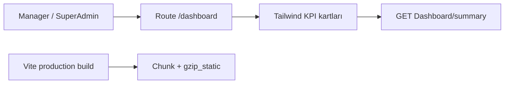
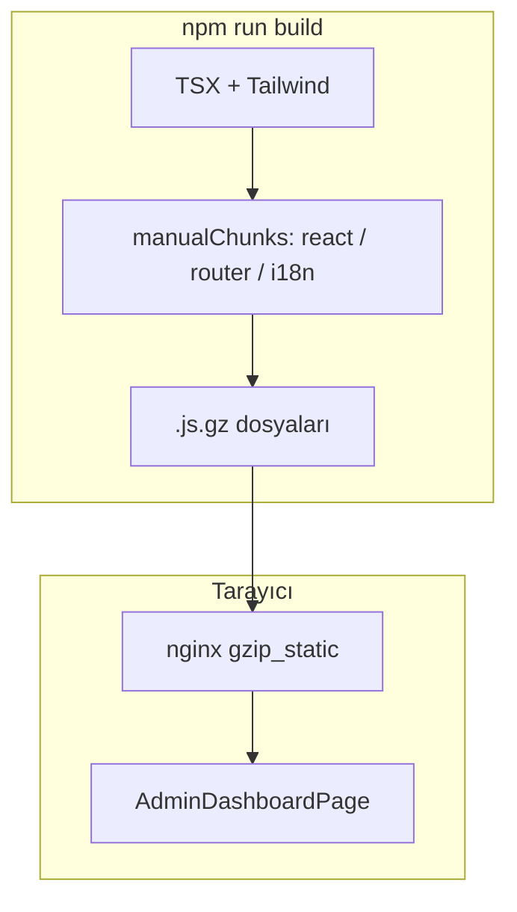

# 32 — Admin karşılama dashboard (Tailwind + paket sıkıştırma)

[← Önceki](31-elk-elasticsearch.md) · [İçindekiler](00-index.md) · [Sonraki →](33-keycloak-lab.md)

İlgili: [11 React + Vite](11-react-vite.md) · Dashboard API (Credit modül)

## Bu nedir?

**Tailwind CSS**, utility-first bir stil kütüphanesidir: hazır küçük sınıflar (`rounded-xl`, `grid`, `px-4` …) yazarsın; build yalnızca **kullandığın** sınıfları pakete koyar.

**Chunking + gzip**, Vite üretim build’inde JS’i parçalara böler (react, router, i18n…) ve nginx’in servis edebileceği **`.gz`** dosyaları üretir — ilk yükleme daha küçük HTTP cevapları alır.

**Benzetme:** Tailwind = LEGO tuğlaları; klasik büyük CSS = önceden yapışmış maket. Chunk/gzip = kargo kutusunu parçalayıp sıkıştırmak.



## Bu projede ne işe yarar?

- Manager / SuperAdmin girişte **`/dashboard`** görür (Tailwind KPI + hızlı linkler)
- Mevcut `GET /api/Dashboard/summary` yeniden kullanılır (yeni backend yok)
- Personel / müşteri hâlâ `/applications` karşılama paneli kullanır
- Compose client imajı: `manualChunks` + `gzip_static`

Ekran: [Bank Manager dashboard](../../screenshots/bank-manager.en.md)

## Ne zaman eklendi?

Faz 6 — Manager ES facet paneli sonrasında (roadmap: Admin Tailwind dashboard).

## Temel kavramlar

| Kavram | Anlam |
|--------|--------|
| Utility class | Tek iş yapan sınıf (`mt-3`, `flex`, `bg-amber-500`) |
| Preflight | Tailwind reset — BankApp’te **kapalı** (eski `index.css` bozulmasın) |
| manualChunks | Vendor paketlerini ayrı JS dosyalarına ayırma |
| gzip_static | nginx hazır `.gz` dosyasını CPU’suz gönderir |
| Admin home | Rol bazlı varsayılan rota (`homePath`) |



## Komutlar

### Bağımlılıkları kur (istemci)

TLS kurumsal proxy sorununda: `$env:NODE_OPTIONS='--use-system-ca'`

```powershell
cd client
npm install
```

Doğrula: `package.json` içinde `tailwindcss`, `@tailwindcss/vite`, `vite-plugin-compression`.

### Geliştirme sunucusu

```powershell
cd client
npm run dev
```

Tarayıcı: http://localhost:3000 — manager ile giriş → `/dashboard`.

### Üretim build + chunk / gzip kontrolü

```powershell
cd client
npm run build
```

Sonra: `dist/assets/` altında `react-vendor-*.js`, `i18n-*.js`, `*.gz` dosyaları olmalı.

### Compose client’ı yeniden build

```powershell
cd infra
docker compose --env-file .env up -d --build client
```

## Sınıflar, metotlar, paketler

- `AdminDashboardPage`, `HomeRedirect`, `homePath()`
- `getDashboardSummary` / `DashboardSummary`
- npm: `tailwindcss`, `@tailwindcss/vite`, `vite-plugin-compression`
- Vite: `manualChunks` + compression plugin; nginx: `gzip_static on`

## Repoda nerede?

- `client/src/pages/AdminDashboardPage.tsx`
- `client/src/styles/tailwind.css`
- `client/src/utils/homePath.ts`
- `client/src/components/HomeRedirect.tsx`
- `client/vite.config.ts`, `client/nginx.conf`
- `client/src/App.tsx`, `AppLayout.tsx`, `LoginPage.tsx`

## Mini akış

1. Manager login → `homePath(true)` → `/dashboard`  
2. Sayfa `getDashboardSummary` çeker → KPI kartları  
3. “Bekleyen” linki → `/applications?status=Pending`  
4. `npm run build` → vendor chunk’lar + `.gz` → nginx `gzip_static`

## Yeni başlayan lab

1. `manager.*@bank.local` ile giriş yap → adres çubuğunda `/dashboard`.
2. KPI sayılarını StatsStrip ile kabaca karşılaştır.
3. Staff hesabıyla giriş → `/dashboard` yerine applications karşılama.
4. `npm run build` çalıştır → `dist/assets/*.gz` var mı bak.

## Sık yapılan hatalar

- Preflight’ı açmak → eski BankApp CSS’i bozulur  
- Tailwind’i `index.css`’ten **sonra** import etmemek → stiller kaybolur  
- Client imajını rebuild etmeden “Tailwind gelmedi” demek  

## Nerede işe yarar?

- [ ] Manager girişinde `/dashboard` açılıyor  
- [ ] KPI sayıları özet ile uyumlu  
- [ ] Staff / müşteri `/applications` karşılama panelini görüyor  
- [ ] `npm run build` sonrası `dist/assets/*.gz` var  
- [ ] Compose client healthy; manager UI Tailwind kartları gösteriyor  

### Felaket / kurtarma (az yıkıcı → çok)

1. `npm run build` lokal hata → `NODE_OPTIONS=--use-system-ca` ile `npm install`  
2. Stil kaybolmuş → `main.tsx`: önce `tailwind.css`, sonra `index.css`  
3. Client imaj eski → `docker compose up -d --build client`  
