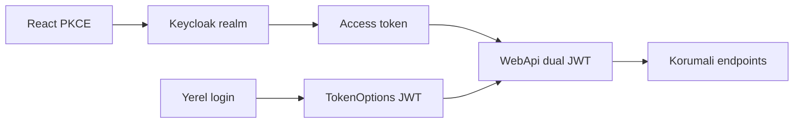
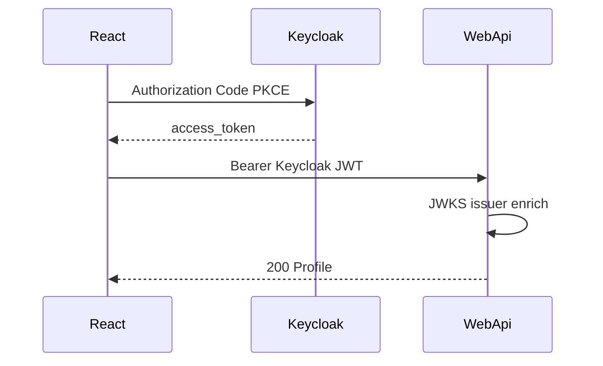

# 33 — Keycloak lab (Compose + dual JWT)

[← Önceki](32-admin-tailwind-dashboard.md) · [İçindekiler](00-index.md) · [Sonraki →](34-a11y-portable-kit.md)

İlgili: [06 JWT / RBAC](06-jwt-rbac.md) · [19 Vault](19-vault-lab.md) · [09 Docker Compose](09-docker-compose.md)

## Bu nedir?

**Keycloak**, açık kaynaklı bir **kimlik ve erişim yönetimi** (IAM) sunucusudur: kullanıcı / rol / istemci (client) tanımlar, OpenID Connect ile **JWT access token** üretir.

**Benzetme:** Bankanın tek gişe kimlik masası (Keycloak): hem kart (PKCE SPA) hem şube içi kart (yerel JWT) kabul eden güvenlik — kapıdaki görevli (WebApi) kartın hangi baskıdan olduğuna bakar.



## Bu projede ne işe yarar?

**Faz 1 — Compose + realm**

- Keycloak `http://localhost:8180`
- Realm `bankapp` import (roller + demo user + `bankapp-api`)
- Password grant ile token

**Faz 2 — WebApi dual JWT (lab)**

- `Keycloak:Enabled=true` iken WebApi hem **yerel** `TokenOptions` JWT hem **Keycloak** access token kabul eder
- Issuer’da `/realms/bankapp` → Keycloak scheme; aksi halde yerel imza
- `role` → `ClaimTypes.Role`; email ile SQL’den `NameIdentifier` / `branchId` / `customerId` zenginleştirme

**Faz 3 — SPA login (PKCE)**

- React: “Keycloak ile giriş” → Authorization Code + PKCE (`oidc-client-ts`)
- Callback: `/login/callback`; access token mevcut `saveSession` / Bearer / SignalR
- Yerel e-posta/şifre formu **kalır** (lab dual path)

**Sosyal OAuth (Identity Brokering)**

- Google / GitHub IdP: secret yoksa kapalı; secret varsa `keycloak-configure-social.sh`
- SPA aynı “Keycloak ile giriş” butonu; sosyal seçim Keycloak hosted login ekranında

## Ne zaman eklendi?

Roadmap “Keycloak desteği” — Faz 1 Compose; ardından Faz 2 dual bearer.

## Temel kavramlar

| Kavram | Anlam |
|--------|--------|
| Realm | İzole kiracı (`bankapp`) |
| Client | `bankapp-api` (public + password grant + PKCE SPA) |
| Authority / JWKS | WebApi imza anahtarını Keycloak’tan çeker |
| Policy scheme | Token issuer’a göre hangi JwtBearer |
| Claim enrich | Keycloak `sub` yerine BankApp user Id |
| PKCE | SPA code flow; `code_challenge` S256 |
| start-dev | Lab modu (prod değil) |



## Komutlar

### Keycloak’ı ayağa kaldır

```powershell
cd infra
docker compose --env-file .env up -d keycloak
```

**Kontrol:** `docker compose ps keycloak` healthy; `http://localhost:8180` (admin/admin).

### Password grant token

```powershell
curl.exe -s -X POST "http://localhost:8180/realms/bankapp/protocol/openid-connect/token" `
  -H "Content-Type: application/x-www-form-urlencoded" `
  -d "grant_type=password" `
  -d "client_id=bankapp-api" `
  -d "username=staff.tr@bank.local" `
  -d "password=Demo123!"
```

### Keycloak token ile korumalı API (Faz 2)

WebApi Development veya Compose’ta `Keycloak__Enabled=true` olmalı.

```powershell
# $TOKEN = access_token alanını yapıştır
curl.exe -s "http://localhost:8080/api/Profile" `
  -H "Authorization: Bearer $TOKEN"
```

**Kontrol:** 401 değil; profil / personel yanıtı (email seed ile eşleşiyorsa `branchId` dolu).  
**Not:** Yerel login token’ı da aynı endpoint’te çalışmaya devam eder.

### SPA Keycloak login (Faz 3)

1. Client build’de `VITE_KEYCLOAK_URL=http://localhost:8180` (Compose args / `client/.env`)
2. `http://localhost:3000/login` → **Keycloak ile giriş**
3. Keycloak’ta `staff.tr@bank.local` / `Demo123!` (veya `manager.tr@`, `customer.tr@`, `superadmin@`)
4. Callback `/login/callback` → dashboard / applications

**Kontrol:** Network’te API istekleri `Authorization: Bearer` Keycloak JWT; UI rolleri (`role` claim) doğru.

Ekran örnekleri:

- SPA Keycloak girişi: [`Login with Keycloak.png`](../../assets/screenshots/en/Login%20with%20Keycloak.png)
- Admin konsol: [`Keycloak Management.png`](../../assets/screenshots/en/Keycloak%20Management.png)

### Realm yeniden import

```powershell
docker compose --env-file .env stop keycloak
docker compose --env-file .env rm -f keycloak
docker compose --env-file .env up -d keycloak
```

### Sosyal IdP (Google / GitHub)

1. Google Cloud / GitHub OAuth app oluştur; redirect URI:  
   `http://localhost:8180/realms/bankapp/broker/google/endpoint`  
   `http://localhost:8180/realms/bankapp/broker/github/endpoint`
2. `infra/.env` içine client id/secret yaz (veya komutta `-e` geçir).
3. Script:

```powershell
cd infra
docker compose --env-file .env exec `
  -e KEYCLOAK_GOOGLE_CLIENT_ID=... `
  -e KEYCLOAK_GOOGLE_CLIENT_SECRET=... `
  -e KEYCLOAK_GITHUB_CLIENT_ID=... `
  -e KEYCLOAK_GITHUB_CLIENT_SECRET=... `
  keycloak /bin/sh /keycloak-configure-social.sh
```

**Kontrol:** Keycloak login sayfasında Google/GitHub butonları; first-broker-login sonrası kullanıcı realm’e eklenir. BankApp enrich için email’in SQL `Users` ile eşleşmesi gerekir (lab’de önce seed kullanıcısı tercih edilir).

**Alternatif:** Admin Console → Realm `bankapp` → Identity providers → Add Google/GitHub.

## Sınıflar, metotlar, paketler

| İsim | Rol |
|------|-----|
| `KeycloakOptions` | Enabled, Authority, ValidIssuers |
| `AddBankAppJwtAuthentication` | Local + Keycloak JwtBearer + `BankApp` policy scheme |
| `KeycloakTokenEnricher` | `role` → Role + SQL enrich |
| `infra/keycloak/bankapp-realm.json` | Realm import |
| `JwtHelper` / Auth login | Yerel token üretimi (değişmedi) |
| `oidc-client-ts` / `keycloakOidc.ts` | SPA PKCE redirect + callback |
| `LoginCallbackPage` | `/login/callback` |

## Repoda nerede?

- `infra/docker-compose.yml` — `keycloak` + WebApi `Keycloak__*` + client `VITE_KEYCLOAK_*`
- `infra/keycloak/bankapp-realm.json`
- `src/WebApi/Configuration/KeycloakOptions.cs`
- `src/WebApi/Authentication/KeycloakAuthenticationExtensions.cs`
- `src/WebApi/Authentication/KeycloakTokenEnricher.cs`
- `src/WebApi/appsettings*.json`
- `client/src/auth/keycloakOidc.ts`, `LoginPage`, `LoginCallbackPage`

## Mini akış

1. Keycloak up → realm import  
2. SPA “Keycloak ile giriş” → PKCE → access_token → `saveSession`  
3. WebApi Bearer Keycloak token → scheme seçimi → JWKS doğrulama → enrich  
4. MediatR RBAC `ClaimRoles()` BankStaff görür  
5. Paralel: yerel form → `POST /api/Auth/login` → BankApp JWT  

## Nerede işe yarar?

- [ ] Admin UI + realm `bankapp`  
- [ ] Token’da `role` içinde `BankStaff`  
- [ ] Keycloak token ile `/api/Profile` (veya staff list) 200  
- [ ] SPA Keycloak butonu → callback → korumalı sayfa  
- [ ] Yerel `Auth/login` token’ı hâlâ çalışıyor  
- [ ] Keycloak kapalıyken (`Enabled=false`) yalnız yerel JWT  

### Felaket / kurtarma

1. `docker compose restart keycloak`  
2. Keycloak recreate (yeniden import)  
3. WebApi log: JWKS / issuer uyumsuzluğu → `ValidIssuers` + `Authority` (Compose’ta `http://keycloak:8080/...`)  
4. Port: `KEYCLOAK_PORT` (8180)

## Yeni başlayan lab

1. `docker compose up -d keycloak` → `http://localhost:8180` admin/admin.
2. Password grant curl ile token al (`staff.tr@bank.local` / `Demo123!`).
3. `Keycloak__Enabled=true` iken `GET /api/Profile` Bearer ile 200.
4. SPA `VITE_KEYCLOAK_URL` → “Keycloak ile giriş” → `/login/callback`.
5. Yerel form login hâlâ çalışır (dual path).

## Sık yapılan hatalar

- Compose **iç** issuer (`http://keycloak:8080/...`) ile tarayıcı **dış** URL karışması — `ValidIssuers` + Authority kontrol.
- `Keycloak:Enabled=false` iken Keycloak token beklentisi → yalnız yerel JWT.
- Sosyal login sonrası enrich yok — email SQL `Users` ile eşleşmeli (lab seed).
- Realm import için volume silmeden `stop/rm/up` — mevcut lab notlarına uy.
- JWKS hatası — webapi log + keycloak healthy.
