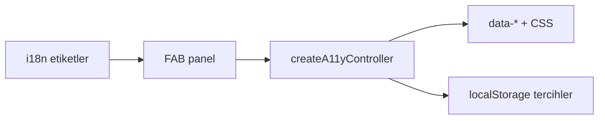

# 34 — Taşınabilir erişilebilirlik kiti (a11y)

[← Önceki](33-keycloak-lab.md) · [İçindekiler](00-index.md)

İlgili: [12 i18n / UX](12-i18n-ux.md) · kit README: [`client/src/a11y/README.md`](../../../client/src/a11y/README.md)

## Bu nedir?

Sayfa üzerinde açılan bir **erişilebilirlik asistanı**: tema, yazı boyutu, kontrast, mavi filtre, görsel gizleme, bağlantı alt çizgisi, hareket azaltma, renk körlüğü profili ve basit sayfa seslendirme.

Kod **ticari bir widget değil**; klasörü kopyalayıp başka SPA’ya taşıyabileceğin **lab kiti**.



## Bu projede ne işe yarar?

- BankApp SPA’da sağ-alt FAB + dikey panel
- Tercihler `localStorage` (BankApp eski `bankapp-*` anahtarlarıyla uyumlu)
- `html` üzerinde `data-theme` / `data-contrast` / `data-a11y-*` + `--font-scale`
- TR / EN / DE etiketler `react-i18next` üzerinden

## Ne zaman eklendi?

UX lab — Keycloak SPA’dan sonra; eski basit toolbar’ın taşınabilir kite genişletilmesi.

## Temel kavramlar

| Kavram | Anlamı |
|--------|--------|
| **Prefs** | Kullanıcı tercih nesnesi (`A11yPrefs`) |
| **Controller** | `createA11yController` — oku / yaz / uygula |
| **data-\*** | CSS’in dinlediği HTML öznitelikleri |
| **TTS** | Tarayıcı `speechSynthesis` (lab; ekran okuyucu yerine geçmez) |
| **Portable kit** | `core.ts` framework’süz; React sadece UI kabuğu |

## Komutlar

Özel CLI yok. Geliştirmede paneli görmek için:

```powershell
# SPA’yı ayağa kaldır (API ayrı çalışıyor olsun)
cd client
npm run dev
```

Tarayıcıda sağ-alt kişi ikonuna tıkla → paneli aç. Tema / A± / filtreleri dene → sayfayı yenile → tercihlerin kaldığını doğrula (`Application` → Local Storage).

Başka projeye taşıma kontrol listesi:

```text
1) a11y/ klasörünü kopyala
2) host CSS: --font-scale + data-theme / data-contrast
3) main/boot: applyA11yPrefs(readA11yPrefs(...))
4) kökte <AccessibilityAssistant labels={...} />
5) DEFAULT_A11Y_KEYS kullan (BankApp legacy değil)
```

## Sınıflar, metotlar, paketler

| Ad | Rol |
|----|-----|
| `createA11yController` | Tercih yaşam döngüsü |
| `applyA11yPrefs` / `readA11yPrefs` | DOM + storage |
| `speakPageText` / `stopSpeaking` | Lab TTS |
| `AccessibilityAssistant` | React FAB + panel |
| `AccessibilityToolbar` | BankApp i18n sarmalayıcı |
| `BANKAPP_A11Y_KEYS` / `DEFAULT_A11Y_KEYS` | Storage anahtar setleri |

NuGet/npm paketi yok — klasör kopyası.

## Repoda nerede?

```
client/src/a11y/core.ts
client/src/a11y/a11y-assistant.css
client/src/a11y/AccessibilityAssistant.tsx
client/src/a11y/index.ts
client/src/a11y/README.md
client/src/components/AccessibilityToolbar.tsx
client/src/main.tsx          # boot
client/src/locales/*/common.json  # a11y.*
```

## Mini akış

Kullanıcı FAB’a basar → panel açılır (`panelOpen`) → “Yüksek kontrast” → `controller.setPrefs` → `localStorage` + `data-contrast=high` → CSS token’ları değişir → yenilemede `main.tsx` boot aynı tercihi uygular.

## Nerede işe yarar?

**Sağlık**

- [ ] FAB görünür (gizlenmediyse)
- [ ] Tema / font / kontrast yenilemede kalır
- [ ] Mavi filtre overlay’i tıklamayı engellemez (`pointer-events: none`)
- [ ] TTS başlar / durur (destekleyen tarayıcıda)

**Lab “felaket / kurtarma” (en az yıkıcıdan)**

1. Panelden **Sıfırla**
2. DevTools → Local Storage → `bankapp-theme` / `bankapp-a11y-*` anahtarlarını sil → yenile
3. Asistan gizlendiyse FAB hâlâ görünür; tıklayınca tekrar açılır
